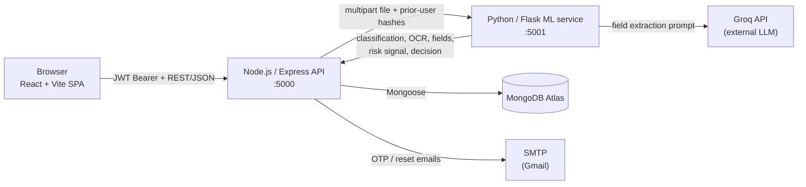

# VerifyAI — AI-Powered KYC Compliance System

A full-stack identity-verification platform that classifies KYC documents (Aadhaar, PAN, Passport), extracts their fields with OCR and an LLM, runs a deterministic graph-based risk check, and produces an explainable Approved / Suspicious / Rejected / Pending decision.


> **This is a demonstration / internship-portfolio project, not a certified KYC or AML decision system.** Its outputs are not legal or regulatory proof of identity and must not be used as the sole basis for a real financial-compliance decision.

## Table of Contents

- [Overview](#overview)
- [Key Features](#key-features)
- [System Architecture](#system-architecture)
- [End-to-End Verification Workflow](#end-to-end-verification-workflow)
- [Technology Stack](#technology-stack)
- [Repository Structure](#repository-structure)
- [Prerequisites](#prerequisites)
- [Installation and Local Setup](#installation-and-local-setup)
- [Environment Variables](#environment-variables)
- [API Reference](#api-reference)
- [Database and ML Artifacts](#database-and-ml-artifacts)
- [Deployment Notes](#deployment-notes)
- [Security and Privacy](#security-and-privacy)
- [Testing](#testing)
- [Troubleshooting](#troubleshooting)
- [Known Limitations](#known-limitations)
- [Engineering Decisions](#engineering-decisions)
- [License](#license)

## Overview

Manual KYC review — a human checking a scanned Aadhaar/PAN/Passport, retyping its fields, and cross-checking it against other records — is slow and inconsistent. VerifyAI automates the mechanical parts of that process: it identifies the document type, reads its text, structures the fields, checks whether the same identifiers appear elsewhere in the system, and applies a fixed set of rules to reach a decision with stated reasons.

**Implemented today:**
- Document upload, classification, OCR, structured extraction, a deterministic risk/decision engine, and a reviewable history — all working end to end.
- Full account security: registration with email verification, optional-but-default-on login 2FA, forgot/reset password, change password, and role-based admin access.

**Not implemented (see [Known Limitations](#known-limitations)):** no automated fraud/forgery image analysis, no face match, no production deployment configuration, no automated frontend/backend test suite.

## Key Features

| Feature | Status |
|---|---|
| Email/password registration with OTP email verification | Implemented |
| Login-time email OTP (2FA), on by default, toggleable per user | Implemented |
| Forgot password / reset password via emailed single-use link | Implemented |
| Change password (authenticated) | Implemented |
| Document upload (identity + optional supporting files) | Implemented |
| CNN-based document type classification | Implemented |
| OCR text extraction | Implemented |
| LLM-based structured field extraction | Implemented |
| Deterministic cross-record graph risk signal | Implemented |
| Deterministic final decision engine with stated reasons | Implemented |
| Verification history, admin-wide view, admin name search | Implemented |
| Role-based access control (admin / user), user management UI | Implemented |
| Trained face-match / forgery-detection model | Not integrated (see [Known Limitations](#known-limitations)) |
| Cloud deployment configuration | Not present in this repository |

## System Architecture

This is the **local-development architecture** — the only one currently configured in this repository. No cloud deployment (hosting, process manager, infrastructure-as-code) exists here; see [Deployment Notes](#deployment-notes).



| Component | Responsibility |
|---|---|
| React/Vite frontend | Auth UI, document upload, verification history, admin user management |
| Node.js/Express backend | Auth (JWT, OTP, 2FA, password reset), authorization, file upload (Multer), MongoDB persistence, orchestrates the ML call |
| Flask ML service | Runs the 5-stage inference pipeline for one uploaded document per request |
| MongoDB Atlas | Users, verification records, short-lived OTP/reset-token collections |
| Groq API | Hosted LLM used only for structured field extraction from OCR text |

## End-to-End Verification Workflow

Each upload goes through five stages, executed synchronously in one `POST /api/kyc/verify` request (`backend/controllers/kyc.js` → `backend/services/mlService.js` → ML service `POST /predict`):

1. **Document classification** — a TensorFlow Lite CNN (`ml-service/inference/classifier.py`, model file `trained models/kyc_classifier.tflite`) classifies the image as `aadhaar`, `pan`, `passport`, or `non_kyc`. This is a **confidence score for document type only** — it is not a decision and not a fraud score.
2. **OCR** — EasyOCR (`ml-service/inference/ocr.py`) extracts raw text from the image, regardless of classification result.
3. **Structured extraction** — the raw OCR text is sent to the Groq API with a document-type-specific prompt (`ml-service/inference/extractor.py`), returning structured fields (e.g. name, document number, DOB). If Groq fails or the OCR text is empty, this is reported as a processing status (`error` / `no_data`), never silently treated as a positive result.
4. **Graph risk signal** — `ml-service/inference/graph.py` compares the current document's extracted identifiers (hashed before leaving the backend — see [Database and ML Artifacts](#database-and-ml-artifacts)) against other users' prior records using NetworkX graph primitives (shared-identifier connections, node degree). **This is a deterministic, rule-based signal, not a trained or learned model** — a project decision documented directly in `ml-service/requirements.txt`: with only a few dozen real records in the database, a trained GNN/embedding model would not have enough data to learn genuine structure rather than noise.
5. **Decision** — `ml-service/inference/decision.py` applies a fixed set of rules to the outputs of stages 1–4 (document type, required-field presence, graph signal) and returns `approved`, `suspicious`, `rejected`, or a `pending`/`error` status with explicit machine-readable reasons. A missing or failed upstream stage never silently becomes "Approved."

**Terminology used consistently throughout this project:**
- *Classification confidence* (stage 1) is how sure the CNN is about the document **type**, not about its authenticity.
- *Graph risk signal* (stage 4) is a deterministic connectivity check, not an anomaly probability or a fraud score.
- *Decision* (stage 5) is the only field that represents an actual verdict; it is derived from, but not equal to, either of the above.

## Technology Stack

| Layer | Technology | Purpose |
|---|---|---|
| Frontend | React 19, Vite, React Router 7 | SPA, routing |
| Backend | Node.js, Express 5, Mongoose 9 | REST API, MongoDB ODM |
| Auth | jsonwebtoken, bcryptjs | JWT sessions, password/OTP hashing |
| Email | Nodemailer (Gmail SMTP) | Registration OTP, login OTP, password-reset emails |
| Uploads | Multer | Multipart file handling |
| ML service | Python 3.12, Flask 3 | Inference HTTP service |
| Classification | ai-edge-litert (TFLite runtime) | Runs the trained CNN |
| OCR | EasyOCR (PyTorch CPU backend) | Text extraction |
| Field extraction | Groq API | Hosted LLM for structuring OCR text |
| Risk signal | NetworkX | Deterministic graph analysis |
| Database | MongoDB Atlas | Persistence |

Backend-to-ML communication uses Node's built-in `fetch`, not a separate HTTP client library. **Not used in this codebase, despite sometimes being associated with similar projects:** PyTorch Geometric, Sentence-Transformers, scikit-learn, Axios, AWS SDK, PM2, Docker — none of these appear in `package.json` or `requirements.txt`.

## Repository Structure

```
.
├── backend/                  # Node.js/Express API
│   ├── controllers/          # admin.js, auth.js, kyc.js
│   ├── middleware/           # auth.js (protect), adminOnly.js, rateLimit.js
│   ├── models/                # User, Verification, EmailVerification, LoginOtp, PasswordReset
│   ├── routes/                # /api/auth, /api/kyc, /api/admin
│   ├── scripts/promoteAdmin.js  # one-time, manually-run admin promotion
│   └── services/              # emailService.js, identityHash.js, mlService.js
├── frontend/                 # React (Vite) SPA
│   └── src/
│       ├── components/        # pages: Login, Register, ForgotPassword, ResetPassword,
│       │                       # Upload, ChatHistory, Account, UserManagement, ...
│       ├── context/AuthContext.jsx
│       └── services/api.js    # all backend API calls
├── ml-service/                # Flask inference service
│   ├── app.py                 # /health, /predict
│   ├── inference/              # classifier.py, ocr.py, extractor.py, graph.py, decision.py
│   └── tests/                  # pytest suite
├── trained models/            # model artifact(s) — see note below
└── notebooks/                  # model training/experimentation notebooks (not used at runtime)
```

> **`trained models/kyc_classifier.tflite` is required for the ML service to start and is not currently present in this repository.** It is produced by `notebooks/Doc detection Notebooks/KYC Identification for Aadhar, Pan and Passport.ipynb` (a Keras/TensorFlow CNN trained on top of EfficientNetV2B0, exported to TFLite). There is no hosted download URL for it — you must either train it yourself from that notebook or obtain the file from whoever last had it. `notebooks/GNN Notebooks/` and `notebooks/Document_Forgery_Detection.ipynb` represent earlier experiments that are **not** wired into the running application — see [Known Limitations](#known-limitations).

## Prerequisites

- **Node.js** 18 or later (uses native `fetch`; confirmed no `axios` dependency)
- **Python** 3.12 (pinned package versions in `ml-service/requirements.txt` target this version)
- A **MongoDB Atlas** cluster (or any reachable MongoDB instance) and its connection string
- A **Groq API key** — [console.groq.com](https://console.groq.com)
- A **Gmail account with an App Password** for SMTP (used for OTP/reset emails) — or another SMTP provider, adjusting `SMTP_*` variables accordingly
- The `trained models/kyc_classifier.tflite` artifact described above

Installing `ml-service`'s Python dependencies (PyTorch, EasyOCR, etc.) takes noticeably longer than the Node installs — budget several minutes, not seconds.

## Installation and Local Setup

Run each service in its own terminal; start them in this order so later services can reach earlier ones.

**1. Clone the repository**
```bash
git clone <your-repo-url>
cd Infosys_AI_KYC_Compliance
```

**2. ML service** (terminal 1)
```bash
cd ml-service
python3 -m venv venv
source venv/bin/activate        # Windows PowerShell: venv\Scripts\Activate.ps1
pip install -r requirements.txt
cp .env.example .env            # then fill in GROQ_API_KEY
# Place trained models/kyc_classifier.tflite at the repo root (see note above)
python app.py
```
Expected: the process starts and listens on port 5001 (`PORT` in `.env`, default `5001`). `GET /health` should respond once it's up.

**3. Backend** (terminal 2)
```bash
cd backend
npm install
cp .env.example .env            # then fill in MONGODB_URI, JWT_SECRET, SMTP_*
node server.js
```
Expected console output: `Server running in development mode on port 5000` and `MongoDB Connected: <host>`.

**4. Frontend** (terminal 3)
```bash
cd frontend
npm install
cp .env.example .env            # VITE_API_BASE=http://localhost:5000/api
npm run dev
```
Open the URL Vite prints (default `http://localhost:5173`, this project has been run on `http://localhost:8000` during development — either is fine as long as it matches `FRONTEND_URL` below).

**5. Promote your own account to admin (optional, one-time)**
After registering a real account through the UI:
```bash
cd backend
node scripts/promoteAdmin.js
```
This script is hardcoded to promote one specific email address, set via the `INITIAL_ADMIN_EMAIL` constant in `backend/scripts/promoteAdmin.js` — edit that constant to your own account's email before running it. It is safe to re-run (no-ops if already an admin) and never runs automatically on server startup.

## Environment Variables

### `backend/.env`

| Variable | Required | Purpose |
|---|---|---|
| `MONGODB_URI` | Yes | MongoDB Atlas (or other) connection string |
| `JWT_SECRET` | Yes | Signs all session and short-lived purpose-scoped tokens |
| `PORT` | No (default `5000`) | Backend listen port |
| `NODE_ENV` | No | `development` / `production` |
| `ML_SERVICE_URL` | Yes | Base URL of the Flask ML service, e.g. `http://localhost:5001` |
| `SMTP_HOST`, `SMTP_PORT`, `SMTP_SECURE`, `SMTP_USER`, `SMTP_PASS` | Yes | SMTP credentials for sending OTP/reset emails |
| `SMTP_FROM` | No | Display "From" address; falls back to `SMTP_USER` |
| `FRONTEND_URL` | Yes | Used to build the password-reset link sent by email |

### `frontend/.env`

| Variable | Required | Purpose |
|---|---|---|
| `VITE_API_BASE` | Yes | Base URL the SPA calls, e.g. `http://localhost:5000/api` |

This is the only frontend variable and contains no secret.

### `ml-service/.env`

| Variable | Required | Purpose |
|---|---|---|
| `GROQ_API_KEY` | Yes | Groq API authentication |
| `PORT` | No (default `5001`) | ML service listen port |
| `FLASK_DEBUG` | No | Flask debug mode |
| `MODEL_PATH` | No | Overrides the default `../trained models/kyc_classifier.tflite` path |
| `GROQ_MODEL` | No | Overrides the default Groq model |

None of these `.env` files are committed — `.env.example` templates with empty/placeholder values exist in each service directory instead.

## API Reference

All endpoints are prefixed `/api`. All request/response bodies are JSON except file upload.

### Auth — `/api/auth`

| Method | Path | Auth | Purpose |
|---|---|---|---|
| POST | `/send-email-otp` | None | Sends a registration OTP to an email |
| POST | `/verify-email-otp` | None | Verifies that OTP, returns a short-lived `verificationToken` |
| POST | `/register` | None | Creates an account (requires a valid `verificationToken`); always assigns `role: "user"` regardless of any `role` sent |
| POST | `/login` | None | Verifies credentials. If the account's `twoFactorEnabled` is true (default), returns `{ twoFactorRequired: true, pending2faToken }` with **no session token**; otherwise returns `{ token, user }` directly |
| POST | `/verify-login-otp` | None (holds `pending2faToken`) | Completes 2FA login, returns `{ token, user }` |
| POST | `/resend-login-otp` | None (holds `pending2faToken`) | Resends the login OTP (60s cooldown) |
| GET | `/me` | Bearer JWT | Returns the authenticated user |
| PATCH | `/two-factor` | Bearer JWT | `{ enabled: boolean }` — toggles the caller's own 2FA |
| PATCH | `/change-password` | Bearer JWT | `{ currentPassword, newPassword, confirmPassword }` |
| POST | `/forgot-password` | None, rate-limited | `{ email }` — always returns the same generic message regardless of whether the account exists |
| POST | `/reset-password` | None, rate-limited | `{ token, newPassword, confirmPassword }` — single-use, 15-minute-expiry token from the reset email |

```bash
curl -X POST http://localhost:5000/api/auth/login \
  -H "Content-Type: application/json" \
  -d '{"email":"user@example.com","password":"your-password"}'
```

### KYC — `/api/kyc` (all routes require a Bearer JWT)

| Method | Path | Purpose |
|---|---|---|
| POST | `/verify` | Upload and run the full pipeline on a document |
| GET | `/history` | List verification records (see below) |

**`POST /verify`** — `multipart/form-data`, fields `identity` (required, one file) and `supporting` (optional, up to 5 files); JPG/JPEG/PNG/PDF, 5 MB max each:
```bash
curl -X POST http://localhost:5000/api/kyc/verify \
  -H "Authorization: Bearer <token>" \
  -F "identity=@/path/to/document.jpg"
```

**`GET /history`** — a normal user always receives only their own records; an admin receives all users' records and may add `?name=<partial-name>` (case-insensitive, regex-escaped) to filter by uploader name. A normal user's `name` query parameter, if sent, is ignored:
```bash
curl "http://localhost:5000/api/kyc/history?name=sheikh" \
  -H "Authorization: Bearer <admin-token>"
```

### Admin — `/api/admin` (all routes require a Bearer JWT belonging to an admin)

| Method | Path | Purpose |
|---|---|---|
| GET | `/users` | List all users (name, email, role, verification/2FA flags, join date — never password or token data) |
| PATCH | `/users/:id/role` | `{ role: "admin" \| "user" }` — promote/demote. Blocked: changing your own role; demoting the sole remaining admin |

A non-admin JWT on any `/api/admin` route returns `403`. No token at all returns `401`.

### ML service (internal only — not intended to be exposed publicly)

| Method | Path | Purpose |
|---|---|---|
| GET | `/health` | Confirms the service and model are up |
| POST | `/predict` | Runs the 5-stage pipeline on one uploaded file; called only by the backend, never directly by the frontend |

## Database and ML Artifacts

MongoDB Atlas via Mongoose, five collections:

| Model | Purpose |
|---|---|
| `User` | `name`, `email`, hashed `password`, `role` (`admin`/`user`, default `user`), `emailVerified`, `twoFactorEnabled` (default `true`) |
| `Verification` | One per upload: owning `user` reference, denormalized uploader `name`, `docType`, `status`, raw OCR text, extracted fields, graph-analysis result, final decision and reasons |
| `EmailVerification`, `LoginOtp`, `PasswordReset` | Short-lived, TTL-indexed collections for registration OTP, login OTP, and password-reset tokens respectively — never store the raw code/token, only a hash, and are deleted on successful use |

**Cross-user privacy in the graph stage:** before any document is sent to the ML service, `backend/services/identityHash.js` hashes other users' extracted identifiers (e.g. PAN/Aadhaar numbers) so the graph stage can detect a shared identifier across records without the ML service ever seeing another user's raw PII.

**Required local artifact:** `trained models/kyc_classifier.tflite` (see [Repository Structure](#repository-structure)) — not currently tracked in this repository; must be trained or obtained separately.

## Deployment Notes

**This repository contains no deployment configuration** — no Dockerfile, no PM2/process-manager config, no infrastructure-as-code, and no AWS SDK/credentials anywhere in `package.json` or `requirements.txt`. All development and testing so far has been local (`node server.js`, `python app.py`, `vite dev`). A separate PDF (`KYC_System_Deployment_Guide.pdf`) in this repository describes an earlier, more elaborate planned AWS EC2/S3 architecture with a trained GNN — that document reflects an **earlier design that was not carried into the current implementation** (the current `graph.py` is explicitly deterministic; see [Engineering Decisions](#engineering-decisions)) and should not be treated as a description of this codebase.

If you deploy this yourself, at minimum:
- Run the backend and ML service as separate processes/containers (they have very different dependency footprints).
- Put a reverse proxy with HTTPS in front of the backend; never expose the Flask ML service's port publicly — only the backend should reach it, over a private network.
- Set `cors()` (currently unrestricted — see [Security and Privacy](#security-and-privacy)) to your actual frontend origin.
- Serve the built frontend (`npm run build` → `frontend/dist/`) from any static host with HTTPS.

## Security and Privacy

**Implemented safeguards**, verified in code:
- Passwords hashed with bcrypt via a Mongoose pre-save hook; never stored or logged in plaintext.
- All OTPs (registration, login) and the password-reset token are hashed before storage (bcrypt for the 6-digit OTPs, SHA-256 for the high-entropy reset token) — raw values exist only in the outgoing email.
- Registration OTP: 10-minute expiry, 5-attempt cap, 60-second resend cooldown. Reset token: 15-minute expiry, single-use (deleted on success).
- `forgot-password` returns an identical response whether or not the email is registered, and is rate-limited.
- JWT role checks are read fresh from the database on every request (`middleware/auth.js`'s `protect()`), not decoded from the token — an admin→user demotion takes effect on the very next request even for an already-issued token.
- KYC history is filtered at the database query level by document owner for non-admins — never fetched unfiltered and hidden in the UI.
- Admin endpoints block self-role-modification and demoting the last remaining admin.

**Known gaps — review before any production use:**
- `app.use(cors())` has no origin restriction — currently accepts requests from any origin.
- `/api/auth/login` and `/api/auth/register` have no rate limiting (only `forgot-password`/`reset-password` do, via a simple in-memory, per-process limiter that resets on restart and does not coordinate across multiple instances).
- Changing or resetting a password does **not** invalidate other already-issued JWT sessions (verified by direct testing) — there is no session/token-versioning or revocation mechanism.
- Uploaded files in `backend/uploads/` are never automatically deleted.
- No face-match or image forgery/tamper detection is implemented, despite related experimentation existing in `notebooks/`.
- Do not use real Aadhaar/PAN/Passport documents or other real identity data when testing or demoing this project — use clearly fake/sample documents only.

## Testing

- **ML service:** a real pytest suite exists at `ml-service/tests/` (`test_classifier.py`, `test_decision.py`, `test_extractor.py`, `test_graph.py`, `test_health.py`, `test_ocr.py`). Run with:
  ```bash
  cd ml-service && source venv/bin/activate && pytest
  ```
- **Backend:** `package.json`'s `test` script is a placeholder (`echo "Error: no test specified" && exit 1`) — there is no automated backend test suite yet.
- **Frontend:** no automated test suite; `npm run build` is the available verification that the app compiles.

No CI workflow is configured in this repository.

## Troubleshooting

| Symptom | Likely cause |
|---|---|
| ML service won't start / model error on boot | `trained models/kyc_classifier.tflite` missing or `MODEL_PATH` misconfigured |
| `torchvision::nms does not exist` | `torch`/`torchvision` versions drifted apart — reinstall both together from the CPU extra index in `requirements.txt` |
| EasyOCR very slow on first request | Expected — model weights load/warm up on first use; CPU-only inference |
| Backend can't reach the ML service | Check `ML_SERVICE_URL` and that the Flask process is actually running |
| CORS error in the browser console | Confirm the frontend origin and that the backend is reachable at `VITE_API_BASE` |
| OTP/reset emails never arrive | Check `SMTP_*` values; Gmail requires an App Password, not your normal account password |
| 401 on every request | Missing/expired `Authorization: Bearer <token>` header |
| 403 on admin routes | The account's `role` is `user` — promote it with `scripts/promoteAdmin.js` or via another admin |
| MongoDB connection failure | Check `MONGODB_URI` and that your IP is allow-listed in Atlas network access |

## Known Limitations

- `trained models/kyc_classifier.tflite` is required but not currently tracked in this repository.
- No automated test suite for backend or frontend.
- No rate limiting on login/registration endpoints.
- Password change/reset does not revoke existing sessions.
- No deployment/infrastructure configuration is included.
- `notebooks/GNN Notebooks/` and `notebooks/Document_Forgery_Detection.ipynb` represent experiments that were never integrated into the running application.
- The in-memory rate limiter (used for password-reset endpoints) is single-process only.

## Engineering Decisions

**Deterministic graph analysis instead of a trained GNN.** `ml-service/requirements.txt` documents this directly: with only a small number of real `Verification` records in the database, a trained GNN or learned embedding model would not have enough data to represent genuine structure rather than noise. NetworkX's deterministic graph-theoretic primitives (shared-identifier connections, node degree) were used instead, which stay accurate and explainable at any data volume.

**Separate Node.js and Python processes.** The backend's dependency footprint (Express, Mongoose, JWT) and the ML service's (PyTorch, EasyOCR, TFLite) are very different in size and startup cost; keeping them as separate services lets either be restarted or scaled independently and keeps a crash in one from taking down the other.

**Model loaded once at process startup**, not per-request, so inference latency doesn't include model-load time after the first request.

**Live role lookup over JWT claims.** User role is re-read from the database on every authenticated request rather than embedded in the JWT, so a role change (or a 2FA/password-security change) takes effect immediately instead of waiting for the token to expire.

## License

[MIT](LICENSE). This project was originally developed as part of an Infosys Springboard internship; the repository's `LICENSE` file is a standard MIT license, which is the license actually governing this code.

---

Built with React, Node.js/Express, Python/Flask, MongoDB Atlas, EasyOCR, and the Groq API.
