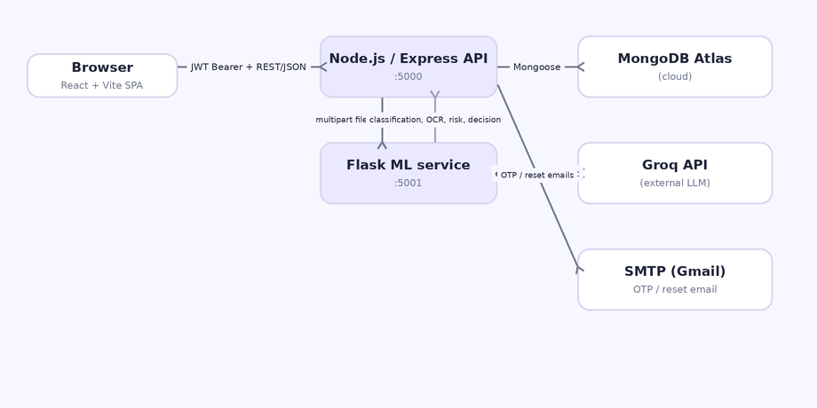
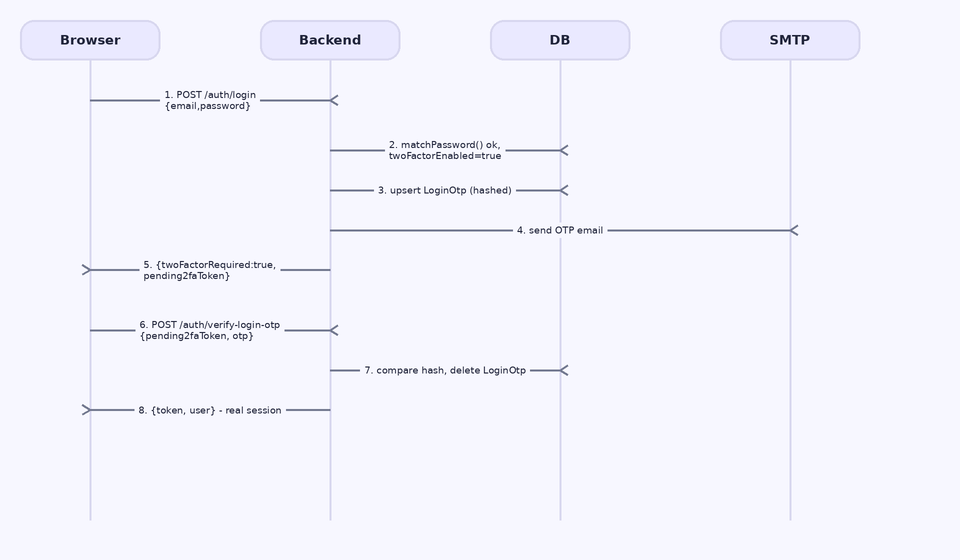
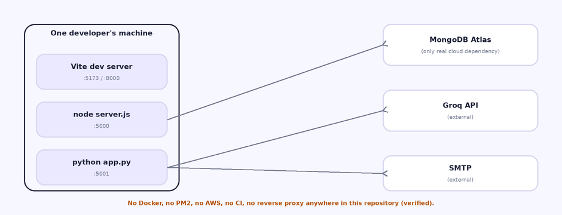
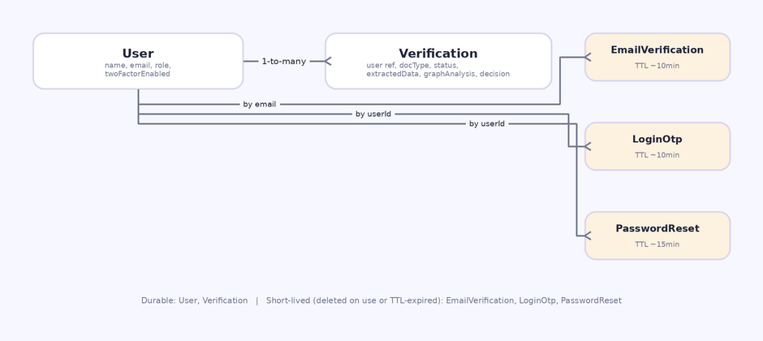
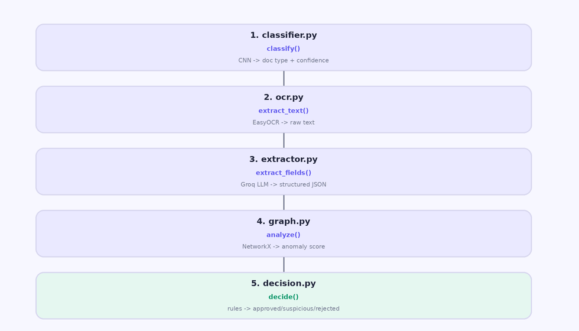

# AI-Powered KYC Verification System

## Complete Technical Documentation

**Document purpose:** a complete, source-verified technical reference for this repository — architecture, every significant source file, the machine-learning pipeline, API contracts, database schemas, configuration, setup, security posture, troubleshooting, and a structured interview-preparation section.

**Generated:** 2026-10-10
**Source of truth:** the actual repository at the time of writing, not the README, not `KYC_System_Deployment_Guide.pdf`, and not assumptions about what a typical KYC system does. Every claim in this manual was checked against source code, configuration files, or direct testing; where something could not be verified, it is labeled explicitly rather than guessed.

---

### Documentation Scope and Coverage Decisions

This manual applies **full depth** (purpose, execution context, every significant function/class with parameters and return values, control flow, connections to other files, and failure scenarios) to the files that determine the system's actual behavior:

- The entire ML service: `app.py` and all six `inference/` modules.
- The entire backend auth/authorization/KYC layer: all controllers, middleware, models, and services.
- The frontend's authentication and core-workflow components: `AuthContext.jsx`, `api.js`, `Upload.jsx`, `Login.jsx`, `Register.jsx`, `ChatHistory.jsx`, `UserManagement.jsx`, `Account.jsx`, `ProtectedRoute.jsx`, `DashboardLayout.jsx`.

It applies **concise but accurate** treatment (purpose, key behavior, what it reuses from an already-documented pattern) to:

- `ForgotPassword.jsx` / `ResetPassword.jsx` (structurally mirror `Login.jsx`'s OTP-step pattern, documented in full there).
- `Landingpage.jsx`, `Learnmore.jsx` (marketing/informational pages with no business logic).
- All `.css` files (pure styling, no logic — listed by purpose, not line-by-line).

This split is a deliberate choice to keep the manual's length proportional to where the actual engineering risk and complexity live, rather than giving a CSS file the same page count as the authentication controller. Every file in the repository is at least listed and categorized in the File Inventory.

**What could not be verified and is stated as such throughout:** the exact internal layer structure of the trained CNN beyond what the training notebook's cells show; any runtime performance/memory figures (none were measured); the GNN/embedding architecture described in `KYC_System_Deployment_Guide.pdf` and the `GNN Notebooks/` folder, because **that code path is not part of the running application** (see "Project History: Two Divergent Designs" in the Architecture chapter).

**What this manual will not claim:** that the system is production-ready, legally compliant, free of security gaps, or that its ML components achieve any particular accuracy. No accuracy/precision/recall figures exist anywhere in this repository, so none are reported here.

## Chapter 1 — System Architecture

### 1.1 Three Independent Processes

The system is three separately-run processes that communicate over HTTP, plus one managed cloud database and two external APIs:

| Process | Technology | Entry point | Default port |
|---|---|---|---|
| Frontend | React 19 + Vite, served by Vite's dev server | `frontend/src/main.jsx` | 5173 (Vite default) / 8000 (used during this project's development) |
| Backend API | Node.js + Express 5 | `backend/server.js` | 5000 |
| ML service | Python 3.12 + Flask 3 | `ml-service/app.py` | 5001 |

MongoDB Atlas (cloud-managed), the Groq API (hosted LLM), and an SMTP server (Gmail, for OTP/reset emails) are the three external dependencies. There is no message queue, no cache layer, no background worker process, and no API gateway — every request is handled synchronously, end to end, inside a single HTTP request/response cycle.



*Figure 1.1 — every arrow is a real, verified call path. The frontend never talks to the ML service or MongoDB directly; the backend is the only component with those credentials/connections.*

### 1.2 Project History: Two Divergent Designs

This repository contains evidence of **two different designs for the risk-analysis stage**, and it is important to be precise about which one is actually running:

1. **An earlier, more ambitious design** — described in `KYC_System_Deployment_Guide.pdf` and partially implemented in `notebooks/GNN Notebooks/` (`Aadhaar_GNN_model.ipynb`, `Pan_Card_GNN_model.ipynb`, `passport_GNN_model.ipynb`). This design called for a trained PyTorch GNN per document type, Sentence-Transformer embeddings, a three-tier AWS EC2/S3 deployment, and PM2 process management.
2. **The design actually implemented and running today** — `ml-service/inference/graph.py`. A code comment in `ml-service/requirements.txt` states the reason for the change directly: *"a trainable GNN is not used: with only ~15-20 real Verification records in this database, there isn't enough data for learned graph embeddings to represent genuine structure rather than noise."* The shipped implementation uses NetworkX's deterministic graph primitives (shared-identifier connections, node degree) instead — see Chapter 5.

**Verified facts supporting this conclusion:**
- `ml-service/requirements.txt` has no `torch-geometric` or `sentence-transformers` entry.
- `ml-service/inference/graph.py` imports only `re`, `hashlib`, and `networkx` — no PyTorch, no model loading.
- No `.pth` GNN model file is loaded by any code path in `ml-service/app.py` or `inference/*.py`.
- There is no AWS SDK, PM2 config, or Dockerfile anywhere in the tracked repository.

This manual documents design #2 throughout, because it is what the code actually does. Where design #1 is referenced (e.g. when explaining why a notebook exists), it is explicitly labeled as historical/unused.

### 1.3 Request/Response Boundary

The frontend authenticates with a JWT Bearer token and talks only to the backend's REST API (`/api/auth/*`, `/api/kyc/*`, `/api/admin/*`). The backend is the only component that:
- Holds the MongoDB connection.
- Holds the SMTP credentials.
- Calls the ML service (`backend/services/mlService.js`, which calls `POST http://<ML_SERVICE_URL>/predict`).

The ML service holds the Groq API key and is the only component that calls Groq. It has no database connection and no knowledge of users, sessions, or JWTs — it receives one document per request and already-hashed identifier data for the graph stage (see §5.5), and returns a single JSON response. It does not persist anything itself; persistence is entirely the backend's responsibility.

### 1.4 Authentication and Authorization Boundary

Every `backend` route except the public auth endpoints (register, login, OTP, password reset) requires a valid JWT in an `Authorization: Bearer <token>` header, checked by `middleware/auth.js`'s `protect()`. Admin-only routes additionally require `middleware/adminOnly.js`, chained after `protect()`. Both middleware modules are documented in full in Chapter 3.

A key architectural property, verified by direct testing during development: **`protect()` re-reads the user's role from MongoDB on every single request** — it does not decode role/permission data from the JWT itself (the JWT only ever carries `{ id }`). This means a role change (admin→user or the reverse) takes effect on the very next API call, even for a session token issued before the change. See Chapter 7 for the authentication sequence diagram and Chapter 9 for the RBAC request trace.



*Figure 1.2 — login with 2FA enabled (the default for every account). If `twoFactorEnabled` is false for that user, the flow collapses to just steps 1–3 with a direct token issuance — see §3.9.*

### 1.5 Deployment Reality (Local Development Only)

**Verified, not inferred:** `git ls-files` shows no Dockerfile, no `ecosystem.config.js` (PM2), no CI workflow file, and no AWS/Terraform configuration anywhere in this repository. `backend/package.json` and `ml-service/requirements.txt` contain no `aws-sdk`, `boto3`, or `pm2` dependency. The only way this project has been run, as far as the repository shows, is three local processes started manually (`node server.js`, `python app.py`, `npm run dev`).



*Figure 1.3 — this is the complete, current runtime picture. `KYC_System_Deployment_Guide.pdf`'s AWS EC2/S3 diagram describes infrastructure that does not exist in this repository; see Chapter 11 for what would actually be required to deploy this.*

### 1.6 Data Persistence Boundary

MongoDB Atlas holds five collections, all accessed exclusively through Mongoose from the backend (never from the ML service or the frontend). Three of the five are short-lived, TTL-indexed, single-purpose token stores; the other two are the actual application data. Full schemas are in Chapter 6.



*Figure 1.4 — `User` and `Verification` are the durable application data. The other three collections exist only for the lifetime of one OTP/reset flow and are deleted on successful use or by MongoDB's TTL sweep on expiry.*

## Chapter 2 — Source Code Reference: ML Service

All paths in this chapter are relative to `ml-service/`.

---

### File: `app.py` (157 lines)

**A. Purpose.** The Flask application itself: process entry point, model initialization at startup, and the two HTTP endpoints (`/health`, `/predict`) that make up the service's entire public surface.

**B. Execution Context.** Runs as `python app.py` (or under any WSGI server). Module-level code (lines 10–22) executes once, at import/startup time: it creates the Flask app and immediately calls `classifier.load_model()` and `ocr.load_reader()` — both are deliberately synchronous, blocking calls made once before the server starts accepting requests, not per-request.

**C. Imports and Dependencies.** `flask` (web framework), `python-dotenv` (`load_dotenv()` reads `ml-service/.env`), and the project's own `inference` package (`classifier`, `ocr`, `extractor`, `graph`, `decision` — each documented below).

**D. Functions and Constants**

- **`health()`** (lines 25–37), `GET /health`. No parameters. Calls `classifier.is_ready()`, `ocr.is_ready()`, `extractor.is_configured()` and returns `200` always, with a body whose `status` field is `"healthy"` only if all three are true, otherwise `"degraded"`. This endpoint never fails with a non-200 status — the degraded state is communicated in the body, not the HTTP status code.
- **`predict()`** (lines 40–151), `POST /predict`. This is the only inference endpoint. Step by step:
  1. Validates a `document` file was actually attached (multipart field name `document`); `400` if not.
  2. Rejects `.pdf` filenames outright with a `400` and an explicit message — neither the CNN nor EasyOCR were ever exercised against PDFs (comment, lines 51–54).
  3. `503` if the classifier failed to load at startup.
  4. Calls `classifier.classify(file_bytes)`. A `ValueError` (corrupt/undecodable image) becomes `400`; any other exception is logged server-side only and becomes a generic `500` — the real exception message is never sent to the client (line 78, "Do not leak internals").
  5. Runs OCR **unconditionally** if the reader is ready, regardless of what the CNN decided the document type is (comment, line 84) — a real document with no legible text is a valid outcome, not an error. OCR failures are caught and logged but never abort the request; `ocr_payload` falls back to an empty-but-well-formed shape.
  6. Calls `extractor.extract_fields(document_class, ocr_payload['raw_text'])` — by design this function never raises (see its own entry below).
  7. Reads `current_user_id` and `existing_identities` (a JSON array) from the multipart form fields, defensively parsing with a `try/except` that falls back to an empty list on any malformed JSON (lines 120–126).
  8. Calls `graph.analyze(...)`, then `decision.decide(...)`.
  9. Returns one `200` JSON body with five top-level keys: `result` (classification), `ocr`, `extraction`, `graphAnalysis`, `decision`. **Every one of these five stages' outputs is included even if that stage degraded** — there is no scenario where the response silently omits a stage.

**E. Execution Logic.** Strictly linear, no branching concurrency. Each stage's output is an input to a later stage only where documented (extraction feeds graph; all four feed decision) — the CNN and OCR stages do not depend on each other and could in principle run in parallel, but the current implementation runs them sequentially in one request thread.

**F. Input/Output.** Input: `multipart/form-data` with `document` (file), optional `current_user_id` (string) and `existing_identities` (JSON string, see `identityHash.js` in Chapter 3). Output: see §5.7 for a full example response body.

**G. Connections.** Called exclusively by `backend/services/mlService.js`'s `classifyDocument()` — never called directly by the frontend. Calls into all five `inference/` modules.

**H. Design Decisions.** Loading models once at startup (not per-request) is explicit and intentional (comment, line 12) — the trade-off is slower startup in exchange for every request after the first being fast. Returning `200` with a degraded body for `/health` rather than a `503` is also deliberate, letting a caller distinguish "service unreachable" from "service reachable but not fully ready."

**I. Failure Scenarios.** Missing/corrupt model file → `classifier.load_model()` returns `False` at startup, `/health` reports `model_loaded: false`, every `/predict` call returns `503`. Missing `GROQ_API_KEY` → service stays fully functional for classification/OCR; extraction degrades to `extraction_status: "error"` per request, never a crash. ML service process down entirely → `backend/services/mlService.js` reports `reachable: false` (see Chapter 3), and the backend still saves a `Pending` verification record rather than losing the upload.

**J. Example.** A `.pdf` upload: response is `{"success": false, "message": "PDF classification and OCR are not supported yet. ..."}`, HTTP `400`.

---

### File: `inference/classifier.py` (92 lines)

**A. Purpose.** Loads the trained TFLite CNN once and exposes a single `classify()` function that turns raw image bytes into a document-type slug and a confidence score.

**B. Execution Context.** `load_model()` is called once from `app.py` at startup. `classify()` is called once per `/predict` request, synchronously, on the request thread.

**C. Imports.** `ai_edge_litert.interpreter.Interpreter` — the lightweight TFLite runtime (deliberately not full TensorFlow; see `requirements.txt` comment, Chapter 8). `.preprocessing.preprocess_image_bytes`.

**D. Functions and Constants**
- **`CLASS_NAMES = ['Aadhaar', 'PAN', 'Passport', 'Non-KYC Document']`** (line 10) — index-to-label mapping, stated in the code comment to be "confirmed against the label-creation and prediction cells in `notebooks/Doc detection Notebooks/Document_Detection.ipynb`, not assumed."
- **`CLASS_SLUGS`** (lines 14–19) — maps the above human labels to the lowercase API slugs used everywhere else in the system (`aadhaar`, `pan`, `passport`, `unknown`).
- **`DEFAULT_MODEL_PATH`** (line 22) — computed relative to this file's own location: `<ml-service>/../trained models/kyc_classifier.tflite`. Overridable via the `MODEL_PATH` environment variable.
- **`load_model()`** (lines 31–55). No parameters. Side effect: sets module-level globals `_interpreter`, `_input_details`, `_output_details`. On any exception (missing file, corrupt model, incompatible format), catches it, sets `_load_error`, prints a clear message, and returns `False` — it never raises out of this function, and never leaves the module in a state where `is_ready()` would incorrectly report success.
- **`is_ready()`** — `True` iff `_interpreter is not None`.
- **`get_load_error()` / `get_load_time_seconds()`** — introspection only, not used by any route currently but available for diagnostics.
- **`classify(file_bytes)`** (lines 70–92). Parameter: raw image bytes. Raises `RuntimeError` if called before `load_model()` succeeded; raises `ValueError` (propagated from `preprocess_image_bytes`) for undecodable bytes. Logic: preprocess → set input tensor → `interpreter.invoke()` → read output tensor → `argmax()` to pick the winning class index → look up its name and slug. Returns a 3-tuple `(slug, confidence, inference_ms)`.

**E. Execution Logic.** No branching beyond the two documented exception paths. The entire inference is one forward pass through the interpreter — there is no retry, no ensembling, no post-processing beyond the argmax.

**F. Input/Output.** Input: raw `bytes` of an image file. Output example: `("pan", 0.9961, 42.3)`.

**G. Connections.** Called by `app.py`'s `predict()`. Calls into `preprocessing.py`.

**H. Design Decisions.** The confidence returned is the raw softmax probability of the winning class — it is a measure of how certain the model is about **document type**, nothing else. This distinction matters and is repeated throughout this manual because it is easy to misread "99.6% confidence" as "99.6% certain this is authentic," which it does not mean.

**I. Failure Scenarios.** Corrupt/non-image bytes → `ValueError`, surfaced by `app.py` as a `400`. Model file absent → `load_model()` fails at startup, every later `classify()` call is unreachable because `app.py` checks `is_ready()` first and returns `503`.

**J. Example.** See §1.3 regarding this model's real architecture (a small custom Conv2D/Dense network trained from scratch at 128×128 input, not a transfer-learning model) — detailed in Chapter 5.

---

### File: `inference/preprocessing.py` (34 lines)

**A. Purpose.** The single shared image-decoding function the CNN classifier depends on, kept in its own module so the exact preprocessing contract (and its provenance) is documented once and reused, not duplicated.

**B. Execution Context.** Called synchronously by `classifier.classify()`, once per request.

**C. Imports.** `PIL.Image`, `numpy`.

**D. Functions and Constants**
- **`IMG_SIZE = (128, 128)`** (line 8) — the code comment states this was verified two ways: against the training notebook's data-loading cells, and against the actually-loaded model's own input tensor shape. This is a directly-verified fact, not a guess.
- **`preprocess_image_bytes(file_bytes)`** (lines 11–34). Decodes bytes → `PIL.Image.open` → `.convert('RGB')` (so grayscale or RGBA input images are normalized) → `.resize((128,128))` → `numpy` array → cast to `float32` → divide by 255 (scale to `[0,1]`) → `np.expand_dims(axis=0)` to add the batch dimension the TFLite interpreter expects. Raises `ValueError` on any decode failure.

**E. Execution Logic.** Linear, no branches other than the single `try/except` around image decoding.

**F. Input/Output.** Input: raw bytes. Output: a `numpy.ndarray` of shape `(1, 128, 128, 3)`, dtype `float32`, values in `[0, 1]`.

**G. Connections.** Called only by `classifier.classify()`.

**H. Design Decisions.** The code comment (lines 17–22) flags a specific, verified discrepancy: the training notebook's own later demo/export cell used `cv2.imread` (which loads images in BGR channel order) without converting to RGB before feeding the model — which would be an inconsistency with the RGB-based training-data loader used during actual training. This file deliberately reproduces the **training-time** RGB contract, not the notebook's possibly-inconsistent demo cell, and says so explicitly. This is noted here as a documented, author-acknowledged known limitation, not resolved by this manual.

**I. Failure Scenarios.** Any bytes that `PIL` cannot open (corrupted file, non-image content, unsupported format) → `ValueError`, which `classifier.classify()` propagates and `app.py` turns into a `400`.

---

### File: `inference/ocr.py` (89 lines)

**A. Purpose.** Wraps EasyOCR: a one-time reader initialization and a per-request text-extraction function.

**B. Execution Context.** `load_reader()` runs once at `app.py` startup. `extract_text()` runs once per `/predict` call where the reader is ready.

**C. Imports.** `easyocr`, `PIL.Image`, `numpy`.

**D. Functions and Constants**
- **`LANGUAGES = ['en']`** (line 13) — English only. The code comment is explicit that this is a scope decision for this phase of the project ("prove text extraction works", not maximize multi-script recall), and flags that Aadhaar cards in particular often carry non-Latin script (e.g. Hindi) that this will not read.
- **`load_reader()`** (lines 20–40) — mirrors `classifier.load_model()`'s pattern exactly: try/except, sets `_reader`/`_load_error`, never raises, returns a boolean.
- **`is_ready()` / `get_load_error()` / `get_load_time_seconds()`** — same introspection pattern as the classifier module.
- **`extract_text(file_bytes)`** (lines 55–89). Decodes the image **independently** of the classifier's preprocessing — the code comment explains why (line 62–65): the CNN's 128×128 resize is far too small for legible text, so OCR needs the original resolution. Calls `_reader.readtext(arr)`, which returns a list of `(bounding_box, text, confidence)` tuples; this function discards the bounding box and returns a list of `{"text", "confidence"}` dicts plus `raw_text` (all detected text strings joined with newlines, in EasyOCR's natural reading order).

**E. Execution Logic.** Linear. Raises `RuntimeError` if the reader isn't initialized, `ValueError` if the bytes can't be decoded as an image.

**F. Input/Output.** Input: raw image bytes. Output: `(detections, raw_text, ocr_ms)`, e.g. `detections=[{"text": "INCOME TAX DEPARTMENT", "confidence": 0.94}, ...]`.

**G. Connections.** Called by `app.py`'s `predict()`. Its output (`raw_text`) feeds directly into `extractor.extract_fields()`.

**H. Design Decisions.** Running OCR on every document regardless of classification result (decided in `app.py`, not here) means this module has no document-type awareness at all — it is a generic text extractor, and all document-specific logic lives downstream in `extractor.py`.

**I. Failure Scenarios.** Reader not initialized (EasyOCR/PyTorch failed to load at startup — e.g. missing native library) → `app.py` never calls this function at all (`is_ready()` check first) and logs the reader was requested but unavailable. Undecodable bytes at this stage, despite having already passed the classifier's own decode step moments earlier, is treated by `app.py` as unusual but non-fatal — logged, not re-raised, OCR payload stays empty.

---

### File: `inference/extractor.py` (226 lines)

**A. Purpose.** Converts raw OCR text into a structured, document-type-specific JSON object using the Groq-hosted LLM, with deterministic validation on top of the LLM's output. This is the file with the most error-handling branches in the ML service.

**B. Execution Context.** `extract_fields()` is called once per `/predict` request, after OCR, before the graph stage. The Groq client itself is lazily constructed and cached on first real use (`_get_client()`), not at Flask startup — only a configuration check (`is_configured()`, no network call) happens at startup.

**C. Imports.** `groq.Groq` (the official SDK), `re`, `json`, `datetime`.

**D. Functions, Classes, Constants**
- **`GROQ_MODEL`** (line 13), default `qwen/qwen3.8-27b`, overridable via `GROQ_MODEL` env var. The code comment (lines 7–12) documents a specific, measured reason for this choice: on a free-tier account, this model answered a full PAN extraction in 161 total tokens / 319ms, while the account's available `gpt-oss` reasoning models spent their entire token budget on hidden reasoning and returned empty output at the same budget — making them both slower and effectively non-functional for this use case under the free-tier limits.
- **`GROQ_TIMEOUT_SECONDS = 15`, `GROQ_MAX_TOKENS = 500`** — request limits.
- **`SCHEMAS`** (lines 20–27) — the exact field list requested per document type:
  - `pan`: `name`, `pan_number`, `date_of_birth`, `father_name`
  - `aadhaar`: `name`, `aadhaar_number`, `date_of_birth`, `gender`, `address`
  - `passport`: `surname`, `given_name`, `passport_number`, `nationality`, `date_of_birth`, `sex`, `date_of_issue`, `date_of_expiry`, `place_of_birth`
- **`CNN_SLUG_TO_DOC_TYPE`** — maps the classifier's `unknown` slug to this module's `non_kyc`, everything else passes through unchanged.
- **`_PAN_RE`** — `^[A-Z]{5}[0-9]{4}[A-Z]$`, the exact statutory PAN format.
- **`_get_client()`** (lines 46–65) — lazy singleton. Returns `None` (never raises) if `GROQ_API_KEY` is unset or client construction fails, recording the reason in `_init_error`.
- **`_normalize_date(value)`** (lines 76–86) — tries six explicit date formats (`%d/%m/%Y`, `%d-%m-%Y`, `%d.%m.%Y`, `%Y-%m-%d`, `%d %B %Y`, `%d %b %Y`) in order; returns `None` (never a guessed date) if none match. The comment is explicit: "Ambiguous or unrecognized format — do not guess."
- **`_validate_field(field_name, value)`** (lines 89–114) — deterministic, non-LLM validation applied after the LLM responds. Dates go through `_normalize_date`. `pan_number` is uppercased, whitespace-stripped, and must match `_PAN_RE` or becomes `None`. `aadhaar_number` must be exactly 12 digits after stripping spaces/hyphens, or becomes `None`. Free-text fields (name, address, etc.) are kept as-is from the LLM but length-capped at 300 characters as a defensive measure — there is no deterministic correctness rule for free text.
- **`_build_system_prompt(doc_type, field_names)`** (lines 117–133) — constructs a 10-rule system prompt whose rules are worth stating verbatim because they are the actual anti-hallucination contract this project relies on: use only the supplied OCR text; never invent, guess, or infer; never use outside knowledge to "fix" a value; unclear/ambiguous fields must be `null`; never convert an uncertain value into a confident-looking one; return only a JSON object with exactly the requested keys; no extra keys; no explanatory text; every value is a string or `null`, never a number/boolean/object.
- **`extract_fields(cnn_slug, ocr_raw_text)`** (lines 136–226) — the main entry point. **Documented guarantee: this function never raises.** Every failure mode becomes a normal return value with an explicit `extraction_status`:
  - `cnn_slug` maps to `non_kyc` → returns immediately with `extraction_status: "not_applicable"`, **Groq is never called** (line 148–151) — the system will not ask an LLM to invent KYC fields for a document the CNN didn't recognize as a KYC type.
  - OCR text is empty/whitespace-only → `extraction_status: "no_data"`, Groq not called.
  - No Groq client available (missing/invalid key) → `extraction_status: "error"`.
  - The Groq API call itself raises any exception (auth failure, rate limit, timeout, network error) → caught, logged (the exception string only — never document content), `extraction_status: "error"`.
  - The response content isn't valid JSON, or isn't a JSON object → caught, logged, `extraction_status: "error"`.
  - Otherwise: only the schema's whitelisted keys are read from the LLM's JSON (any extra key the LLM added is silently dropped, line 211–216); each value passes through `_validate_field`. The final `extraction_status` is computed by counting non-null validated fields: `0` → `"no_data"`, all present → `"success"`, otherwise → `"partial"`.

**E. Execution Logic.** A sequence of early-return guard clauses (non-KYC, empty OCR, no client) followed by the actual API call wrapped in two separate `try/except` blocks (one for the network call, one for JSON parsing) — each with its own logged failure path, so a problem at one stage doesn't look like a problem at another when reading logs later.

**F. Input/Output.** Input: `cnn_slug` (e.g. `"pan"`), `ocr_raw_text` (string). Output example:
```json
{"document_type": "pan", "extraction_status": "success",
 "fields": {"name": "RAVI KUMAR", "pan_number": "ABCDE1234F",
            "date_of_birth": "1990-05-12", "father_name": "SURESH KUMAR"}}
```
(fictional values)

**G. Connections.** Called by `app.py`. Its output's `fields` dict is the direct input to `graph.hash_fields()`.

**H. Design Decisions.** `temperature=0` and `response_format={'type': 'json_object'}` (line 183–184) are both explicit choices to make the LLM's output as deterministic and parseable as possible, reducing (not eliminating) the JSON-parsing failure path.

**I. Failure Scenarios.** All six are enumerated in §D above — this is one of the few files in the codebase where every failure path was traced and given its own explicit status rather than a generic catch-all.

---

### File: `inference/graph.py` (185 lines)

**A. Purpose.** The deterministic, NetworkX-based risk signal — the replacement for the earlier, abandoned trained-GNN design (§1.2). Detects whether the current document's extracted identifiers (PAN/Aadhaar/passport number, name) also appear on a **different user's** prior record.

**B. Execution Context.** `analyze()` runs once per `/predict` request, after extraction, before the final decision.

**C. Imports.** `re`, `hashlib`, `networkx as nx`.

**D. Functions and Constants**
- **`STRONG_FIELDS = {'pan_number', 'aadhaar_number', 'passport_number'}`, `WEAK_FIELDS = {'name'}`** — a shared government ID number is treated as a much stronger signal than a shared name, since common names collide innocently far more often.
- **`STRONG_MATCH_WEIGHT = 0.5`, `WEAK_MATCH_WEIGHT = 0.15`, `MAX_ANOMALY_SCORE = 1.0`, `HIGH_RISK_THRESHOLD = 0.5`** (lines 13–16) — these are stated in the code comment to be deterministic, explainable, hand-chosen weights, **not learned from any dataset**.
- **`_normalize_identity_value(value)`** — trim, uppercase, strip all internal whitespace. The code comment is emphatic that this **must match `backend/services/identityHash.js`'s `normalizeIdentityValue()` byte-for-byte**, because Node and Python don't share code — any divergence silently breaks cross-record matching for values that are actually the same in the real world.
- **`_hash_identity_value(value)` / `hash_fields(fields)`** — SHA-256 of the normalized value. `hash_fields` extracts the three strong fields plus a combined name (for passports, `surname + " " + given_name`) and returns only the hashes that exist. **Used only for the current request's own fields** — hashes for every other record arrive already computed, via `existing_identities`, so this service never receives another user's raw PAN/Aadhaar/name.
- **`analyze(current_user_id, document_type, current_fields, existing_identities)`** (lines 72–185) — the main entry point. **Documented guarantee: never raises for expected conditions.**
  - `document_type == 'non_kyc'` → `status: "not_applicable"` immediately.
  - Nothing could be hashed from `current_fields` (extraction found nothing) → `status: "insufficient_data"`. The code comment is explicit that this is **not the same as "searched and found no risk"** — it means no search was possible at all.
  - No prior records exist anywhere → also `status: "insufficient_data"`.
  - Otherwise: builds an in-memory `networkx.Graph`. One node for the current document (`'current'`); one node per identifier hash the current document has; an edge from `'current'` to each identifier node. Then, for every prior record, for every identifier hash the current document has, if that *other* record has the same hash under the same field name, a node for that other record is added and connected to the shared identifier node — and, **only if the other record belongs to a different user** (`other_user_id != current_user_id`), that user is added to `strong_match_users` or `weak_match_users` depending on whether the shared field was a strong or weak one. A user's own repeat upload of their own document is explicitly excluded from counting as a match against themselves.
  - `strong_count` / `weak_count` are computed (weak count excludes anyone already counted as a strong match, to avoid double-counting one user twice).
  - Human-readable `signals` strings are built only when counts are non-zero (e.g. `"A strong identifier (PAN/Aadhaar/passport number) is shared with 2 other user(s)"`).
  - `anomaly_score = min(1.0, strong_count*0.5 + weak_count*0.15)`, rounded to 4 decimals.
  - `risk_level`: `"high"` if `anomaly_score >= 0.5`, `"medium"` if `> 0`, else `"low"`.
  - `graphFeatures` reports `connectedUsers`, `connectedVerifications`, `nodeDegree` (NetworkX's own `graph.degree()`), and `connectedComponentSize` (`nx.node_connected_component`) — these are the actual deterministic graph-theoretic primitives referenced throughout this project as the replacement for a trained GNN.
  - Any unexpected internal exception is caught at the outer level and becomes `status: "error"` with an empty result — never a fabricated score.

**E. Execution Logic.** One pass building the graph, one pass computing counts/score — no iteration beyond what's needed to compare the current document against every prior record once.

**F. Input/Output.** See §D for the full field-by-field output shape. Example (fictional): `{"status": "success", "anomalyScore": 0.5, "riskLevel": "high", "signals": ["A strong identifier (PAN/Aadhaar/passport number) is shared with 1 other user(s)"], "graphFeatures": {"connectedUsers": 1, "connectedVerifications": 1, "nodeDegree": 1, "connectedComponentSize": 3}}`.

**G. Connections.** Called by `app.py`. Reads `existing_identities`, which `backend/controllers/kyc.js` builds by querying every *other* user's prior `Verification` records and hashing their fields via `backend/services/identityHash.js` **before** this request is even sent (Chapter 4, §4.2).

**H. Design Decisions.** This is the file most directly tied to the project's central engineering decision — see Chapter 10 for the full rationale on why a deterministic graph replaced a trained model.

**I. Failure Scenarios.** Any NetworkX internal error (not expected in normal operation given the simple graph construction here) → caught, logged, `status: "error"`. Malformed `existing_identities` (not a list) is already defended against one layer up, in `app.py`.

---

### File: `inference/decision.py` (137 lines)

**A. Purpose.** The final, deterministic rules engine. Consumes the outputs of the four stages above and produces the one field (`decision.decision`) that actually represents a verdict.

**B. Execution Context.** `decide()` runs once per `/predict` request, last, after classification, OCR, extraction, and graph analysis are all already computed in the same request.

**C. Imports.** None beyond the standard library (pure rule logic, no model, no external call).

**D. Functions and Constants**
- **`RULE_VERSION = '1.0'`** — included in every decision result so a future rule change is traceable in stored records.
- **`REQUIRED_FIELDS`** — the minimum fields a decision can be reached without: `pan`: `name`, `pan_number`; `aadhaar`: `name`, `aadhaar_number`; `passport`: `passport_number` (passport's name requirement is handled specially, see below). The code comment clarifies this is a deliberate policy choice for this phase — a smaller, mandatory subset of `extractor.py`'s full `SCHEMAS`, not every field worth attempting to extract.
- **`_result(status, decision, reasons)`** — a small constructor returning the four-key shape `{status, decision, reasons, ruleVersion}`.
- **`_missing_required_fields(doc_type, fields)`** — returns the list of required fields that are `None`/absent. Passport is special-cased: the name requirement is satisfied by *either* `surname` or `given_name` being present (passports split the name into two fields; there's no single `name` field for them).
- **`_has_strong_graph_signal(graph_analysis)`** — checks whether `graph_analysis['signals']` contains a message starting with `"A strong identifier"` (matching `graph.py`'s exact wording for the strong-match case).
- **`decide(document_class, confidence, ocr_payload, extraction, graph_analysis)`** — the main entry point. In order:
  1. Defensive guard: if any of the four inputs is `None`, returns `status: "error"`. (Not reachable from the live `app.py` flow, which always supplies real dicts, but kept for standalone testability.)
  2. `document_class == 'non_kyc'` → `status: "success", decision: "rejected"`, reason `"Document was classified as a non-KYC document"`. This is treated as a **confident rejection**, not a processing gap — the CNN gave a real, decisive answer.
  3. `document_class` not one of the three known KYC types → `status: "error"` (a safety net only; the classifier's own slug mapping is a closed set, so this should not be reachable in practice).
  4. `extraction_status == 'error'` → `status: "error"`, reason `"Automated field extraction could not be completed"`. **A Groq failure is explicitly a processing failure, never evidence the document is invalid.**
  5. `graph_status == 'error'` → `status: "error"`, reason `"Automated risk analysis could not be completed"`.
  6. `extraction_status == 'no_data'` → `status: "pending"`, reason `"Insufficient data was extracted from the document to make a determination"`. **Insufficient OCR/extraction is insufficient evidence, not proof the document is bad.**
  7. From here, extraction succeeded (fully or partially) and graph analysis did not error. If any required field is still missing → `status: "success", decision: "rejected"`, reason `"Required identity field(s) could not be validated"`.
  8. If `graph_status == 'success'` and a strong graph signal was found → `status: "success", decision: "suspicious"`, reason `"Strong identity relationship detected across different users"`.
  9. Otherwise → `status: "success", decision: "approved"`, reasons `["Supported KYC document", "Required identity fields extracted successfully", "Deterministic identity validation passed", "No blocking graph anomaly detected"]` (exact reason text may vary slightly by code path; the four-reason shape is representative).

**E. Execution Logic.** A strict, ordered sequence of guard clauses — each one is checked only if all prior ones did not already return. This ordering is itself meaningful: processing failures (extraction/graph `error`) are checked and returned **before** any content-based rejection/approval logic runs, which is what guarantees a system failure never becomes a false "Approved" or a false "Rejected."

**F. Input/Output.** Output is always exactly `{status, decision, reasons: [...], ruleVersion}`. `status` is one of `success` / `pending` / `error`. `decision` is one of `approved` / `suspicious` / `rejected` / `null` (null whenever status isn't `success`).

**G. Connections.** Called last by `app.py`. Its output is persisted by `backend/controllers/kyc.js` into `Verification.decision`, and is also what moves the top-level `Verification.status` field away from `Pending` (see Chapter 6).

**H. Design Decisions.** Chapter 10 covers this in depth, but the single most important property of this file, verified directly by reading every branch above, is: **there is no code path in `decide()` that converts a processing failure or missing data into `approved` or `rejected`.** Those two decisive outcomes are reachable only through genuine, complete evidence.

**I. Failure Scenarios.** This file does not itself fail in the sense of raising exceptions under normal conditions — its entire job is to turn upstream failures into one of the three defined `status` values. A bug here would be a logic error (wrong branch reached), not a runtime crash; there is a dedicated pytest suite (`tests/test_decision.py`) covering these branches (Chapter 13).

## Chapter 3 — Source Code Reference: Backend

All paths relative to `backend/`.

---

### File: `server.js`

**A. Purpose.** Process entry point: creates the Express app, connects to MongoDB, registers global middleware, mounts the three route modules, and starts listening.

**B. Execution Context.** Runs as `node server.js`. Top-to-bottom execution at process start.

**D. Key elements.** `connectDB()` — an async function wrapping `mongoose.connect(process.env.MONGODB_URI, { serverSelectionTimeoutMS: 5000 })`; on failure, logs the error and calls `process.exit(1)` — the server does not start in a half-connected state. Global middleware, in registration order: `express.json()` (body parsing), `cors()` (see Chapter 8 for why this is a security note, not just a feature), `express.static()` for `/uploads`. Route mounts: `app.use('/api/auth', auth)`, `app.use('/api/kyc', kyc)`, `app.use('/api/admin', admin)`. Two inline routes: `GET /` (plain text liveness message) and `GET /api/health` (returns Mongoose's `connection.readyState` translated to a human string).

**G. Connections.** Imports `routes/auth.js`, `routes/kyc.js`, `routes/admin.js`. Every other backend file is reachable only through this file's route registration.

**H. Design Decisions.** `cors()` is called with **no options**, which means it reflects/allows any origin. This is flagged again in Chapter 8 as a real, unmitigated gap for a production deployment.

---

### File: `middleware/auth.js` — `protect()`

**A. Purpose.** The single authentication gate used by every protected route in the system.

**D. Function: `protect(req, res, next)`.** Reads `Authorization: Bearer <token>`; `401` if absent. `jwt.verify(token, process.env.JWT_SECRET)` — `401` ("Invalid or expired token") if this throws. **Then re-fetches the user from MongoDB by `decoded.id`** (`User.findById`) — `401` ("User no longer exists") if that user was deleted since the token was issued. Only then sets `req.user` to the full Mongoose document and calls `next()`.

**H. Design Decisions — the single most architecturally important fact in this codebase's authorization model:** because `protect()` loads the user fresh from the database on *every* request rather than trusting claims embedded in the JWT, any field on `User` (`role`, `twoFactorEnabled`, etc.) is always current as of the moment of the request. This is what makes `adminOnly.js` safe to implement as a simple field check (below) and is what was directly verified by testing in §9.3 (a promoted-then-demoted user's pre-existing token lost admin access on its very next request, with no new login).

**I. Failure Scenarios.** Expired token → `401`. Token signed with a different secret → `401`. Token structurally valid but for a deleted user → `401`, distinct message.

---

### File: `middleware/adminOnly.js`

**A. Purpose.** The authorization gate for admin-only routes. **D.** `adminOnly(req, res, next)`: `401` if `req.user` is unset (meaning it was called without `protect()` running first — a usage error this guards against); `403` ("Admin access required") if `req.user.role !== 'admin'`; otherwise `next()`. **G.** Always mounted after `protect()` — see `routes/admin.js`. **H.** Depends entirely on `protect()`'s live-lookup guarantee above; this file itself does not re-query the database.

---

### File: `middleware/rateLimit.js`

**A. Purpose.** A minimal, dependency-free rate limiter, used only on `POST /api/auth/forgot-password` and `POST /api/auth/reset-password`.

**D. `createRateLimiter({ windowMs, max, message })`** — a factory returning Express middleware. Internally keeps an in-memory `Map<ip, {count, windowStart}>`. On each request: if no entry exists for that IP, or the window has elapsed, resets the counter to 1 and allows the request. If the count is already at `max`, returns `429` with `message`. Otherwise increments and allows.

**H. Design Decisions, stated plainly in the code's own comment:** this is **in-memory and per-process** — it resets on every server restart and does not coordinate across multiple server instances. This is an accepted trade-off for a single-process deployment, not a production-grade distributed rate limiter, and is documented as a known limitation (Chapter 12).

**I. Failure Scenarios.** None — this is a pure counter with no external dependency that could fail. The only "failure" is the documented scaling limitation above.

---

### File: `controllers/auth.js` (706 lines — the largest file in the backend)

This single file implements registration-OTP, login, login-time 2FA, password change, and forgot/reset password. It is organized here by feature group rather than line-by-line, since the file itself is organized that way.

**Shared helpers (top of file):**
- **`buildSafeUser(user)`** — the *only* function anywhere in the backend that shapes a `User` document for an API response. Returns exactly `{id, name, email, twoFactorEnabled, role}`. **Password, OTP hashes, and reset-token hashes live on separate collections entirely and are never read by this function in the first place** — there is no field to accidentally include.
- **`signToken(user)`** — `jwt.sign({ id: user._id }, JWT_SECRET, { expiresIn: '30d' })`. This exact shape (`{id}` only) is what makes `protect()`'s live-role-lookup property hold.
- Constants: `OTP_EXPIRY_MINUTES = 10`, `OTP_MAX_ATTEMPTS = 5`, `RESEND_COOLDOWN_SECONDS = 60` (shared by registration OTP and login OTP), `VERIFICATION_TOKEN_EXPIRES_IN = '15m'`, `PENDING_2FA_TOKEN_EXPIRES_IN = '10m'`, `RESET_TOKEN_EXPIRY_MINUTES = 15`.
- **`generateOtp()`** — `crypto.randomInt(0, 1000000)` zero-padded to 6 digits. A CSPRNG, deliberately not `Math.random()`.
- **`generateResetToken()` / `hashResetToken()`** — `crypto.randomBytes(32).toString('hex')` (256 bits of entropy) hashed with SHA-256 (not bcrypt — a design decision explained in Chapter 10: a high-entropy random token doesn't need bcrypt's deliberate slowness, unlike a 6-digit OTP).

**Registration OTP:**
- **`sendEmailOtp(req, res)`** — `POST /auth/send-email-otp`. Validates email format. Enforces the 60-second resend cooldown by checking an existing `EmailVerification` document's `lastSentAt`. Generates an OTP, bcrypt-hashes it, **upserts** the `EmailVerification` document (so a second request for the same email replaces, never duplicates). Calls `emailService.sendOtpEmail()`; a send failure returns `502` with a generic message (the real SMTP error is logged server-side only, never sent to the client).
- **`verifyEmailOtp(req, res)`** — `POST /auth/verify-email-otp`. Validates the 6-digit format. Loads the `EmailVerification` record; `400` if missing/expired. `429` if `attempts >= 5`. `bcrypt.compare()` the submitted code; a mismatch increments `attempts` and returns `400` — correct code marks the record `verified: true` and returns a short-lived `verificationToken` JWT with payload `{email, purpose: 'email_verification'}`. **This payload deliberately has no `id` field**, so `protect()` can never resolve it to a real user — it is structurally incapable of being used as a session token.
- **`register(req, res)`** — `POST /auth/register`. Requires `name`, `email`, `password`, and `verificationToken`. Verifies the token's signature, `purpose`, and that its `email` matches the submitted email. Re-checks the `EmailVerification` record's `verified` flag (belt-and-braces — the token alone proves it was legitimately issued, but this DB check is what makes it single-use). Creates the user with **`role: 'user'` hardcoded in the `User.create()` call, regardless of anything else in the request body** — this is the actual mass-assignment defense, verified directly in this file, not merely assumed. Deletes the `EmailVerification` record on success (one-time consumption) — explicitly *not* deleted on a later unrelated failure, so a transient error doesn't burn the user's verification.

**Login and 2FA:**
- **`login(req, res)`** — `POST /auth/login`. Validates credentials via `User.matchPassword()` (bcrypt compare). **Branches on `user.twoFactorEnabled`:** if `false`, issues a session token immediately (`signToken` + `buildSafeUser`) — identical behavior to before 2FA existed. If `true` (the default for every account), calls the shared `issueLoginOtp(user)` helper and returns `{twoFactorRequired: true, pending2faToken}` — **no session token or user object is included in this branch at all.**
- **`issueLoginOtp(user)`** (shared helper, not a route) — generates/hashes/stores a `LoginOtp` document (upserted, keyed by `userId`, enforcing the same 60s cooldown), emails it via `emailService.sendLoginOtpEmail()`, and signs a `pending2faToken` with payload `{userId: user._id.toString(), purpose: 'login_2fa'}`. **The payload key is `userId`, not `id`** — the same structural defense as the registration token, verified directly in this file.
- **`verifyLoginOtp(req, res)`** — `POST /auth/verify-login-otp`. Verifies the pending token's signature/purpose, loads the matching `LoginOtp` record, checks expiry and the 5-attempt cap, `bcrypt.compare()`s the code, and on success **deletes the `LoginOtp` record** (one-time use) before issuing the real session token.
- **`resendLoginOtp(req, res)`** — re-runs `issueLoginOtp` for the user identified by a still-valid `pending2faToken`.
- **`updateTwoFactor(req, res)`** — `PATCH /auth/two-factor`, behind `protect()`. Sets `req.user.twoFactorEnabled` from the request body and saves — operates only on the authenticated caller's own account (`req.user`, never an id from the body).

**Password change and reset:**
- **`changePassword(req, res)`** — `PATCH /auth/change-password`, behind `protect()`. Re-fetches the user **with the password field explicitly selected** (`.select('+password')` — `protect()`'s own lookup excludes it, since the schema marks it `select: false`), verifies `currentPassword` via `matchPassword()`, rejects if the new password equals the old one (via a direct `bcrypt.compare` against the stored hash), then **assigns `user.password = newPassword` as plaintext and calls `.save()`** — the hashing happens automatically in `models/User.js`'s pre-save hook (below); this function never calls `bcrypt.hash()` itself, which is exactly what prevents double-hashing.
- **`forgotPassword(req, res)`** — `POST /auth/forgot-password`, rate-limited. **Returns the identical generic message on every code path** — valid email, invalid-format email, unknown email, an email that's on cooldown, and even an unexpected internal error all produce the same `200` response body, `FORGOT_PASSWORD_GENERIC_MESSAGE`. Internally, only if a real user exists and is not on cooldown does it actually generate a token, upsert a `PasswordReset` document, and send the email — but none of that internal branching is ever visible to the caller.
- **`resetPassword(req, res)`** — `POST /auth/reset-password`, rate-limited. The submitted raw token is hashed and used as the **sole lookup key** into `PasswordReset` — no user id is ever accepted from the request body. Checks expiry, sets the new password (again via plaintext assignment + `.save()`, never manual hashing), and **deletes the `PasswordReset` record** on success. **Returns no session token** — the spec for this feature explicitly required that a password reset never auto-logs the user in, and this function has no `signToken()` call anywhere in it.

**H. Design Decisions (file-wide).** Every token type in this file that is *not* a full session token (`verificationToken`, `pending2faToken`) deliberately avoids a field literally named `id` in its JWT payload, for the single reason stated in `middleware/auth.js`'s entry above: `protect()` resolves any JWT with an `id` field to a real session, regardless of a `purpose` claim. This pattern appears three separate times in this file and is the project's primary defense against a partially-completed auth flow being escalated into a full session.

---

### File: `controllers/kyc.js`

**D. `verifyDocuments(req, res)`** — `POST /kyc/verify`. Requires `req.files.identity` (one file, via Multer); `400` if absent (and any `supporting` files that were already written to disk are cleaned up before returning, so a validation failure doesn't leave orphaned files). Creates a `Verification` document immediately (`status: 'Pending'`, `docType: 'Pending Classification'`) **before** calling the ML service — so the upload is never lost even if the ML service is down. Queries every *other* `Verification` record that has `extractedData.fields`, hashes their identifiers via `identityHash.js`'s `hashIdentityFields()` (never sending raw PII), and passes that as `existingIdentities` to `mlService.classifyDocument()`. On a reachable ML response, updates the `Verification` document's `docType`, `confidence`, `ocrText`, `extractedData`, `graphAnalysis`, and `decision` fields — and **only if `decision.status === 'success'`** does the top-level `status` field move away from `'Pending'`, mapped via `{approved: 'Approved', suspicious: 'Suspicious', rejected: 'Rejected'}`. An unreachable ML service leaves the record exactly as created — `Pending`, with no ML fields populated — rather than erroring the whole upload.

**D. `getHistory(req, res)`** — `GET /kyc/history`. **The ownership filter is one line:** `const filter = req.user.role === 'admin' ? {} : { user: req.user.id }`. For an admin, an additional `?name=<string>` query parameter is honored — trimmed, regex-escaped (`escapeRegex`, defined in this file), and applied as a case-insensitive `RegExp` against the `name` field, merged into the same `filter` object used for the ownership query, **combined in one single `Verification.find(filter)` call** — never an unfiltered fetch followed by in-memory filtering. For a non-admin, the `name` parameter is simply never read, regardless of what's sent.

**H. Design Decisions.** The `escapeRegex` helper (`str.replace(/[.*+?^${}()|[\]\\]/g, '\\$&')`) exists specifically so a user-supplied search string can't alter the meaning of the constructed regex or build an unintentionally expensive pattern — verified directly by testing with a deliberately regex-hostile name during development (§9.4).

---

### File: `controllers/admin.js`

**D. `listUsers(req, res)`** — `GET /admin/users`, behind `protect()` + `adminOnly()`. Uses `.select('name email role emailVerified twoFactorEnabled createdAt')` — an explicit field **allowlist**, so there is no field on the schema (password, anything else added later) that could leak through this endpoint by accident.

**D. `updateUserRole(req, res)`** — `PATCH /admin/users/:id/role`, body `{role}`. Validates the id is a real Mongo ObjectId and `role` is exactly `'admin'` or `'user'`. **Blocks self-modification**: `if (String(req.user._id) === String(target._id)) return 403`. **Blocks demoting the last admin**: if the target is currently an admin and is being set to `user`, counts other admins (`User.countDocuments({role:'admin', _id:{$ne: target._id}})`) and returns `400` if that count is zero.

**H. Design Decisions — a verified, honestly-documented limitation:** because this endpoint is itself admin-gated, the *caller* is always an admin distinct from a self-demotion attempt (which is already blocked separately). This means the "last admin" count check can only ever be reached when at least two admins exist — at which point demoting one always leaves the other, so the count is never actually zero in practice. **This was confirmed by direct testing, not assumed**: with a single admin, attempting self-demotion correctly hits the self-check message, not the last-admin message; no reachable test scenario triggers the last-admin message specifically. The code is not wrong — the outcome it protects (the system never reaching zero admins) is still fully guaranteed by the self-check — but the dedicated count-based branch is effectively dead code under the current endpoint design.

---

### File: `models/User.js`

Fields: `name` (required, trimmed), `email` (required, unique, lowercased, regex-validated), `password` (required, min length 6, `select: false` — never returned by a default query), `emailVerified` (Boolean, default `false`), `twoFactorEnabled` (Boolean, **default `true`**), `role` (enum `['admin', 'user']`, default `'user'`), `createdAt` (default `Date.now`).

**Pre-save hook** — hashes `password` with bcrypt (`genSalt(10)` + `hash`), but **only if `isModified('password')`**; otherwise returns immediately. The code comment documents a real bug that existed here and was fixed: Mongoose 9's async pre-save hooks are promise-based and are never passed a `next` callback, so an earlier version of this hook that called `next()` in the "password not modified" branch crashed with `"next is not a function"` — invisible for a long time because every earlier code path that called `.save()` also happened to modify the password, until the 2FA-toggle feature added the first `.save()` that didn't.

**Method `matchPassword(enteredPassword)`** — `bcrypt.compare()` against the stored hash.

---

### File: `models/Verification.js`

Fields, in the order the schema actually declares them: `user` (ObjectId ref `User`, required — the ownership field every query filters on), `name`/`initials` (denormalized from the uploader at creation time, so an admin's combined-user view doesn't need a join), `docType`, `docTypeSub`, `date` (default now), `confidence`, `status` (enum `Approved`/`Pending`/`Rejected`/`Suspicious`, default `Pending`), `details` (an object with `faceMatch`/`forgeryDetection`/`documentStatus`/`extractedName`/`extractedAddress` — **present on the schema but never written to by any controller code**, verified by grep; a leftover from earlier planning, documented here rather than silently omitted), `originalFilename`/`identityFile`/`supportingFiles`, `ocrText`, `extractedData` (`{documentType, extractionStatus, fields: Mixed}`), `graphAnalysis` (`{status, anomalyScore, riskLevel, signals, graphFeatures: Mixed}`), `decision` (`{status, decision, reasons, ruleVersion}`).

---

### File: `models/EmailVerification.js`, `models/LoginOtp.js`, `models/PasswordReset.js`

All three share one shape and purpose: a short-lived, single-purpose token store.

| | Keyed by | Secret field | Hash algorithm | TTL index on |
|---|---|---|---|---|
| `EmailVerification` | `email` (unique) | `otpHash` | bcrypt | `expiresAt`, `expireAfterSeconds: 0` |
| `LoginOtp` | `userId` (unique) | `otpHash` | bcrypt | same |
| `PasswordReset` | `userId` (unique) | `tokenHash` | SHA-256 | same |

The `unique` index on the owner field is what makes every "send a new OTP/token" operation an **upsert** rather than an insert — issuing a new one always replaces (invalidates) any prior one for that same owner, by construction, not by an extra explicit delete step. The `expireAfterSeconds: 0` TTL index is MongoDB's own periodic-sweep cleanup, explicitly documented in each file's comment as a convenience **only** — the actual expiry check used to accept/reject a code is always an explicit `Date.now()` comparison in the controller, since TTL sweeps don't run instantly.

---

### File: `services/emailService.js`

**D.** `getTransporter()` — lazily constructs and caches a single Nodemailer transporter from `SMTP_*` env vars; returns `null` (no error thrown) if any required var is missing. `isConfigured()` — boolean wrapper. Three send functions, one per email type, each with its own subject line and copy: `sendOtpEmail` ("Verify your VerifyAI email"), `sendLoginOtpEmail` ("Your VerifyAI login code"), `sendPasswordResetEmail` ("Reset your VerifyAI password", includes the reset link built from `FRONTEND_URL`). **Every one of the three catches its own `sendMail` failure and re-throws a single generic `Error('Email provider rejected the request')`** — the real SMTP error (which can include auth details) is never allowed to propagate to a caller; it exists only in the error object the caller may choose to log server-side.

### File: `services/identityHash.js`

Documented in full already in Chapter 2's discussion of `graph.py`, since the two files form one matched pair. The important fact restated here: `normalizeIdentityValue()` in this file and `_normalize_identity_value()` in `graph.py` must stay byte-for-byte identical, because the two languages don't share code — this is called out as a real, standing maintenance risk (Chapter 12).

### File: `services/mlService.js`

Documented in full in Chapter 2 (§ `app.py` connections). One addition: `classifyDocument()` uses an `AbortController` with an 8-second timeout (`ML_SERVICE_TIMEOUT_MS`), and distinguishes `reachable: false` (network-level failure — service down, DNS failure, timeout) from `reachable: true` with a non-2xx `status` (the service responded, just with an error for this particular file) — this distinction is what lets `kyc.js` know whether to treat the upload as "saved but not yet processed" versus "the ML service rejected this specific file."

---

### File: `scripts/promoteAdmin.js`

**A. Purpose.** The one-time, manually-run script that creates the system's first admin. **Not imported by `server.js` and never runs automatically** — this was a specific design requirement (never hardcode an automatic email-based promotion into startup or ordinary request handling).

**D.** A single hardcoded constant, `INITIAL_ADMIN_EMAIL`, normalized (trim + lowercase) before lookup. If no matching user exists, logs an error and exits with a non-zero code — **it never creates an account**. If the user already has `role: 'admin'`, logs that and exits 0 (idempotent, safe to re-run). Otherwise sets `role = 'admin'` and calls `.save()` — which touches only the `role` field, so the pre-save hook's `isModified('password')` guard (above) correctly skips re-hashing.

**I. Note for anyone publishing this repository:** the `INITIAL_ADMIN_EMAIL` constant currently holds a real email address belonging to this project's account owner. If this repository is made public, that value should be replaced with a placeholder or moved to an environment variable before publishing — this was flagged during the README-writing task and is repeated here for completeness.

## Chapter 4 — Source Code Reference: Frontend

All paths relative to `frontend/src/`.

---

### File: `context/AuthContext.jsx`

**A. Purpose.** The single source of truth for "who is logged in" across the entire SPA — a React Context provider wrapping the app.

**D. State.** `user` (the `buildSafeUser`-shaped object from the backend, or `null`), `token` (initialized from `localStorage.getItem('kyc_token')`), `loading` (true until the initial session check completes).

**D. Effects and functions.**
- A mount-time `useEffect` with no dependencies: if no token exists in `localStorage`, sets `loading: false` and stops. Otherwise calls `authApi.me(token)`. On success, sets `user`. **On a `401` specifically**, clears the token (treats it as a genuinely invalid/expired session). **On any other failure (network error, 5xx)**, the token is deliberately left alone — the code comment explains this is so a transient backend restart doesn't silently log the user out.
- **`login(newToken, userData)`** — the only function that establishes a session: writes the token to `localStorage` and sets both `token` and `user` state. Called by `Login.jsx`, `Register.jsx`, `ResetPassword.jsx` (indirectly — reset does not call this, by design) only after a real, complete authentication success.
- **`logout()`** — clears `localStorage` and both state values.
- **`updateUser(partial)`** — merges a partial object into the existing `user` state (e.g. `{twoFactorEnabled: false}` after a Settings toggle) without touching `localStorage` or re-fetching — added specifically so `Account.jsx`'s 2FA toggle and `UserManagement.jsx`'s role changes can reflect immediately without a full page reload.

**G. Connections.** Every component in the app that needs to know the current user or make an authenticated request calls `useAuth()`, the hook this file exports. It is the only file that touches `localStorage` for the session token.

**H. Design Decisions.** `user` itself is never persisted to `localStorage` — only the token is. This means a hard refresh always re-derives `user` from a fresh `/auth/me` call, which is also what guarantees a role change is reflected after a reload (consistent with the backend's live-lookup design in Chapter 3).

---

### File: `services/api.js`

**A. Purpose.** The only file in the frontend that constructs a `fetch()` call to the backend — every component goes through this.

**D.** `request(path, {method, body, token})` — a shared helper: sets `Content-Type: application/json`, adds `Authorization: Bearer <token>` if a token was passed, JSON-stringifies the body, and always returns `{ok, status, data}` (never throws for a non-2xx response — a component checks `ok`/`data.success` itself). `authApi` exports one function per backend auth endpoint (11 total, matching Chapter 8's API reference exactly). `adminApi` exports `listUsers` and `updateUserRole`. `kycApi.verify` is the one exception to the shared `request()` helper — it builds a `FormData` body directly (for the multipart file upload) and does not set a `Content-Type` header itself, deliberately, so the browser can set the correct multipart boundary. `kycApi.history(token, nameSearch)` appends `?name=<encoded>` to the URL only when `nameSearch` is truthy.

---

### File: `components/ProtectedRoute.jsx`

**D.** Wraps `children`. While `loading`, renders a centered "Checking session..." message. If not authenticated, `<Navigate to="/login" replace />`. **New prop: `adminOnly`** — if set and `user?.role !== 'admin'`, redirects to `/upload`. The code comment is explicit that this check is a **UX convenience only** — the real security boundary is the backend's `adminOnly` middleware (Chapter 3); this component existing or being bypassed has no bearing on whether the API actually permits the request.

---

### File: `components/DashboardLayout.jsx`

**A. Purpose.** The shared shell (sidebar + topbar) wrapping every authenticated page (`Upload`, `ChatHistory`, `Account`, `UserManagement`).

**D.** `PAGE_TITLES` — a path-to-title lookup used for the topbar breadcrumb. Sidebar navigation links: New Verification, Verification History, Settings, and — **conditionally, only when `user?.role === 'admin'`** — User Management. A mobile hamburger menu with its own open/close state and a backdrop overlay. A user-profile dropdown with Sign Out (which calls `useAuth().logout()` after a `window.confirm`).

**H. Design Decisions.** The admin nav item's visibility check is the frontend half of the same "hide, don't rely on hiding" pattern as `ProtectedRoute`'s `adminOnly` — both exist purely so a non-admin's UI doesn't show controls that would just fail server-side anyway.

---

### File: `components/Login.jsx`

**A. Purpose.** A two-step state machine: credentials, then (conditionally) a 2FA OTP step.

**D. State.** `step` (`'credentials'` | `'otp'`), `formData` (`email`, `password`), `otpDigits` (array of 6 single-character strings), `pending2faToken` (held only in component state — **never written to `localStorage`**), `cooldown` (resend timer, driven by a `useEffect`/`setInterval` pair).

**E. Execution logic.** `handleSubmitCredentials` calls `authApi.login`. If the response has `data.twoFactorRequired`, stores `pending2faToken`, resets the OTP boxes, switches to the `'otp'` step, and starts the 60-second cooldown. Otherwise (2FA disabled for that account) it calls `useAuth().login(token, user)` directly and navigates to `/upload` — identical to the pre-2FA behavior. `handleVerifyOtp` calls `authApi.verifyLoginOtp`; success calls `login()` + navigates, failure clears the boxes and shows the server's message. Digit input handling (`handleOtpDigitChange`, `handleOtpKeyDown`, `handleOtpPaste`) implements auto-advance-on-type, backspace-to-previous-box, and paste-a-full-code-at-once — this exact pattern is reused unchanged in `Register.jsx`'s own OTP step.

**I. Failure Scenarios.** Every `catch` block around a fetch call sets an error state to the *actual* caught error's message (e.g. `Unable to reach the server: Failed to fetch`) rather than a generic string — a deliberate choice made during development specifically because a generic message had previously made a real connectivity bug very hard to diagnose from the UI alone (§13, Troubleshooting).

---

### File: `components/Register.jsx`

Structurally the same three-step pattern as `Login.jsx`'s OTP step, extended with a third step: `'details'` (name/email) → `'otp'` (6-digit code, identical digit-handling code to `Login.jsx`) → `'verified'` (password + confirm-password fields, unlocked only after OTP success). The `verificationToken` returned by OTP verification is held only in component state and sent once, with the final `register()` call — never stored in `localStorage`.

### File: `components/ForgotPassword.jsx`

A single email field and a "Send Reset Link" button. **Always shows the identical success message after a submission that the backend accepted** (`If that email is registered, a password reset link has been sent...`) — the component does not and cannot distinguish "email exists" from "email doesn't exist," because the backend's response is itself generic (Chapter 3).

### File: `components/ResetPassword.jsx`

Reads `token` from the URL query string via `useSearchParams()`. New-password + confirm-password fields with independent show/hide toggles. Client-side validates length and match before submitting (mirroring, not replacing, the backend's own validation). On success, shows a confirmation and a link to `/login` — **it does not call `useAuth().login()`**, consistent with the backend never issuing a session token for this flow.

---

### File: `components/Upload.jsx` (610 lines — the largest frontend component)

**A. Purpose.** The "New Verification" page: file selection for the required identity document and optional supporting documents, the upload action, and the results display.

**D. State machine.** `aiStatus`: `'idle'` → `'scanning'` → `'results'`. `mainFile` / `supportingFiles` (File objects, browser-only, never persisted). `result` (the full `data.data` object from the backend's `/kyc/verify` response, stored as-is once received).

**D. Key functions.** `getStageStates(aiStatus, result)` — a pure function (not a component) that derives a truthful per-stage UI status (`waiting`/`processing`/`completed`/`pending`/`failed`/`skipped`) for each of the five pipeline stages **from the actual response fields**, never from elapsed time. For example: the classification stage is `'failed'` if `docType` is still the placeholder `'Pending Classification'`; the extraction stage reads `extraction.extractionStatus` directly; if classification itself failed, every later stage is marked `'skipped'` rather than guessed. During the `'scanning'` state (before any response exists), every stage is shown collectively as `'processing'` — the code comment is explicit that this is because the backend returns one final result, not incremental per-stage events, so showing a specific stage as "currently running" would be a fabrication.

**D. `handleStartVerification`** — calls `kycApi.verify(token, mainFile, supportingFiles)`; on success stores the full response in `result` and moves to `'results'`; on failure shows the real error message and returns to `'idle'`.

**D. Results rendering.** A `DECISION_DISPLAY` lookup maps `approved`/`suspicious`/`rejected` to a label, CSS class, and (for suspicious/rejected) an explanatory note. **If `decision.status !== 'success'`**, the UI explicitly shows "Pending" rather than defaulting to any particular decision — there is no code path that displays an decision the backend didn't actually return. Extracted fields are rendered through a `maskValue(key, value)` helper that partially masks `pan_number`/`aadhaar_number`/`passport_number` (showing only the last 4 characters) before display.

**H. Design Decisions.** This file went through several iterations during development specifically to remove fabricated progress indication (a numeric percentage progress bar was replaced with a genuine CSS-only indeterminate animation) — documented here as a real example of a UI choice that was deliberately made *less* flashy in order to stay truthful to what the backend can actually report.

---

### File: `components/ChatHistory.jsx`

**A. Purpose.** The "Verification History" page — a metrics summary, a filter bar, and a results table.

**D.** `isAdmin = user?.role === 'admin'`. Four filters: `searchTerm` (admin-only, debounced 300ms before being sent to the backend as `?name=`), `statusFilter`, `dateFilter`, `docFilter` (the latter three applied client-side to whatever record set the backend already returned). The search input itself is only rendered in the DOM at all when `isAdmin` is true — a non-admin user never receives this control, consistent with the backend ignoring the parameter for them regardless. A `filtersActive` flag drives a "Clear filters" affordance, and the empty-state message is context-aware: it distinguishes "no records exist at all" from "your filters matched nothing" from "no admin search results for this name" — three different messages for three different real situations, rather than one generic "no data" message in all cases.

---

### File: `components/UserManagement.jsx`

**A. Purpose.** The admin-only user list and role-management page.

**D.** Fetches `adminApi.listUsers(token)` on mount. Each row shows name/email/role badge/join date and, for every user except the currently logged-in admin themselves (`isSelf` check, disabled with "Not editable"), a Promote/Demote button. `handleRoleChange` shows a `window.confirm()` dialog naming the target user and the new role **before** calling `adminApi.updateUserRole` — no role change happens without this confirmation step. On success, updates the local list in place (no full re-fetch needed) via `setUsers`.

---

### File: `components/Account.jsx`

**A. Purpose.** The Settings page: profile display, Change Password (expand/collapse form), the 2FA toggle, and two notification toggles.

**D.** The 2FA toggle (`twoFactor` state) is initialized from `user?.twoFactorEnabled` and kept in sync via a `useEffect`; `handleToggleTwoFactor` calls `authApi.updateTwoFactor`, and on success calls `AuthContext`'s `updateUser()` so the change is reflected everywhere in the app immediately, not just in this component. The Change Password section is collapsed by default; clicking expands a form with three password fields (current/new/confirm), each with its own show/hide toggle, submitting to `authApi.changePassword`; on success the form collapses and a success message shows, on failure it stays open with the real error.

**I. Note.** The "Email Alerts for High Risk Fraud" and "Push Notifications for New Verifications" toggles on this page are **local component state only** — they call no API and persist nothing. This is flagged explicitly in Chapter 12 as a feature that looks implemented in the UI but is not backed by any real functionality.

---

### Concise entries: remaining components

- **`components/Landingpage.jsx`** — the public marketing page. No business logic; contains the product description, a pipeline-stage overview, and navigation links to `/login` and `/register`. Its content was specifically reviewed during development to ensure it describes the deterministic graph analysis accurately (never calling it a trained GNN) and makes no fabricated accuracy/customer claims.
- **`components/Learnmore.jsx`** — a secondary informational page, similarly static.
- **CSS files** (`styles/*.css`) — one stylesheet per auth page plus a shared `dashboard.css`; pure presentation, no logic. `Login.css` is the shared base that `Register.css`, `ForgotPassword.css`, and `ResetPassword.css` all `@import`, which is why the six-digit OTP box styling, the input show/hide toggle, and the generic auth-error/auth-success banners look identical across all four pages — they are, literally, the same CSS rules.

## Chapter 5 — ML Pipeline Summary and Terminology

Chapter 2 documents each ML-service file in full; this chapter consolidates the pipeline as a whole and is explicit about the four different numbers the system produces, which must not be confused with one another.

### 5.1 The Four Numbers

| Term | Produced by | Range | What it actually measures |
|---|---|---|---|
| Classification confidence | `classifier.py` (`classify()`) | `[0, 1]` softmax | How certain the CNN is about **document type** (Aadhaar/PAN/Passport/Non-KYC). Says nothing about authenticity. |
| Extraction status | `extractor.py` (`extract_fields()`) | categorical: `success`/`partial`/`no_data`/`error`/`not_applicable` | Whether structured fields could be read from the OCR text — a data-completeness signal, not a score. |
| Anomaly score | `graph.py` (`analyze()`) | `[0, 1]`, `min(1, 0.5·strong + 0.15·weak)` | A deterministic count of how many *other users* share this document's strong/weak identifiers — a connectivity measure, not a learned probability. |
| Decision | `decision.py` (`decide()`) | `approved` / `suspicious` / `rejected` / `null` | The only field that is an actual verdict, computed from fixed rules applied to the three numbers above plus required-field presence. |

### 5.2 Model and Dataset Inventory

| Artifact | Format | Produced by | Loaded by | Tracked in git? |
|---|---|---|---|---|
| `trained models/kyc_classifier.tflite` | TFLite (INT8-quantized) | `notebooks/Doc detection Notebooks/Document_Detection.ipynb` | `inference/classifier.py` | **No — was tracked, currently deleted from the working tree.** The ML service cannot start without it. |
| EasyOCR's own pretrained weights | PyTorch, downloaded by the `easyocr` package itself on first use | A third party (EasyOCR project), not this repository | `inference/ocr.py` | No — not part of this repository at all; downloaded automatically by the library. |
| Groq-hosted LLM (`qwen/qwen3.8-27b` by default) | Hosted API, no local file | N/A — external service | `inference/extractor.py` | N/A |

Three `.pth` GNN checkpoints and three `.npy` HOG feature files existed in `trained models/` earlier in this project's history and were confirmed, by direct code inspection, to be loaded by **no code path** in the current `ml-service/` — they belonged to the abandoned design in §1.2 and were removed during repository cleanup.

### 5.3 Pipeline Sequence



*Figure 5.1 — the actual, verified order of operations inside one `POST /predict` call, as traced through `app.py`. Stages 1 and 2 (classification, OCR) do not depend on each other and run in this order only because the code happens to call them sequentially, not because of a data dependency between them; stages 3 and 4 each depend on stage 2's and stage 3's output respectively; stage 5 depends on all four prior outputs.*

### 5.4 What This Pipeline Does Not Establish

Stated plainly, because the project's own disclaimers depend on this: the CNN confirms a document *looks like* a given type's layout; OCR and the LLM extract *what text is printed on it*; the graph stage detects *whether the same identifier appears elsewhere in this system's own database*. **None of these four stages performs image forensics, face matching, hologram/security-feature verification, or any check against an external government identity registry.** A well-made fake document with internally consistent, unique-looking text would not be caught by this pipeline — this is stated explicitly rather than left implicit, per the project's own "do not overstate" requirement.

---

## Chapter 6 — Database and Data Lifecycle

### 6.1 Collections

Already introduced in Chapter 3's model entries; this section adds the lifecycle view.

**`User`** — durable, one document per account for the life of the account. **`Verification`** — durable, one document per upload, never updated after its ML fields are populated (no "edit a past verification" feature exists anywhere in the code). **`EmailVerification` / `LoginOtp` / `PasswordReset`** — each lives for, at most, `OTP_EXPIRY_MINUTES` (10) or `RESET_TOKEN_EXPIRY_MINUTES` (15), and is explicitly deleted by the controller on successful use, or swept by MongoDB's TTL index if left unused until expiry.

### 6.2 Verification Record Lifecycle (traced through actual code)

1. **Created** — `controllers/kyc.js`'s `verifyDocuments()`, immediately after file upload validation, with `status: 'Pending'` and placeholder `docType`. This happens **before** the ML call, so a crash or timeout talking to the ML service still leaves a real, queryable record.
2. **Enriched** — if the ML service was reachable, the same function writes `docType`, `confidence`, `ocrText`, `extractedData`, `graphAnalysis`, `decision` onto the same document and saves it once.
3. **Status promotion** — only if `decision.status === 'success'` does `status` move away from `Pending`.
4. **Read** — `getHistory()`, filtered by ownership (non-admin) or optionally by name (admin), sorted by `-date`.
5. **No deletion path exists anywhere in the codebase.** There is no endpoint, script, or scheduled job that removes a `Verification` document or its associated uploaded file. This is listed again in Chapter 12 as a real, verified retention gap for a system that processes identity documents.


*(Same figure as Chapter 1, repeated here for chapter-local reference.)*

### 6.3 Representative Documents (fictional data only)

```json
// User
{
  "_id": "65f0...", "name": "Asha Rao", "email": "asha@example.com",
  "role": "user", "emailVerified": true, "twoFactorEnabled": true,
  "createdAt": "2026-01-15T09:00:00Z"
  // password: <bcrypt hash, select:false, never returned by default>
}
```

```json
// Verification
{
  "_id": "65f1...", "user": "65f0...", "name": "Asha Rao", "initials": "AR",
  "docType": "pan", "confidence": 0.9961, "status": "Approved",
  "originalFilename": "pan_card.jpg",
  "extractedData": {
    "documentType": "pan", "extractionStatus": "success",
    "fields": { "name": "ASHA RAO", "pan_number": "ABCDE1234F",
                "date_of_birth": "1995-03-20", "father_name": "RAMESH RAO" }
  },
  "graphAnalysis": { "status": "success", "anomalyScore": 0, "riskLevel": "low",
                      "signals": [], "graphFeatures": { "connectedUsers": 0 } },
  "decision": { "status": "success", "decision": "approved",
                "reasons": ["Supported KYC document", "Required identity fields extracted successfully"],
                "ruleVersion": "1.0" }
}
```

---

## Chapter 7 — End-to-End Execution Traces

Each trace below lists the real function call sequence, file by file, for one user-visible workflow. "Absent" workflows (from the original request list) are stated as such rather than invented.

### 7.1 Registration (with email OTP)

1. `frontend/.../Register.jsx` `handleSendOtp` → `api.js` `authApi.sendEmailOtp(email)` → `POST /api/auth/send-email-otp` → `controllers/auth.js` `sendEmailOtp()` → generates/hashes OTP → upserts `EmailVerification` → `emailService.sendOtpEmail()`.
2. User enters the code → `handleVerifyOtp` → `authApi.verifyEmailOtp` → `verifyEmailOtp()` → `bcrypt.compare` → on match, marks the record verified and returns a `verificationToken`.
3. User sets a password → `handleRegister` → `authApi.register(name, email, password, verificationToken)` → `register()` → verifies the token, creates the `User` with `role: 'user'` hardcoded, deletes the `EmailVerification` record.
4. Frontend navigates to `/login` — **registration does not log the user in automatically.**

### 7.2 Login (2FA enabled — the default)

See Figure 1.2. `Login.jsx` → `POST /auth/login` → credential check → `issueLoginOtp()` → OTP emailed, `pending2faToken` returned (no session token yet) → user enters code → `POST /auth/verify-login-otp` → `verifyLoginOtp()` → `LoginOtp` record checked and deleted → real session token issued → `AuthContext.login()` called → `localStorage` written → navigate to `/upload`.

### 7.3 Document Upload and Verification

1. `Upload.jsx` `handleStartVerification` → `kycApi.verify(token, file)` (multipart) → `POST /api/kyc/verify`.
2. `middleware/auth.js` `protect()` resolves `req.user`.
3. Multer writes the file(s) to `backend/uploads/`.
4. `controllers/kyc.js` `verifyDocuments()` creates the `Verification` document (`Pending`).
5. Queries other users' prior records with extracted fields; hashes them via `identityHash.js`.
6. `services/mlService.js` `classifyDocument()` → `POST http://<ML_SERVICE_URL>/predict`.
7. Inside the ML service: `classifier.classify` → `ocr.extract_text` → `extractor.extract_fields` → `graph.analyze` → `decision.decide` (Chapter 2, Figure 5.1).
8. Response returns to `kyc.js`, which writes the five ML-derived fields onto the `Verification` document and saves once.
9. Backend responds with the full result; `Upload.jsx` stores it in `result` state and renders via `getStageStates()` and the `DECISION_DISPLAY` lookup.

### 7.4 Verification History Retrieval (including the Admin/RBAC path)

1. `ChatHistory.jsx` mounts → `kycApi.history(token, isAdmin ? debouncedSearch : undefined)` → `GET /api/kyc/history?name=...`.
2. `protect()` resolves `req.user`.
3. `getHistory()` builds `filter` from `req.user.role` (own-records-only, or unrestricted + optional name regex for an admin) and issues **one** `Verification.find(filter)` call.
4. Response is mapped to the list shape the table renders; client-side status/date/document-type filters are applied on top of this already-scoped set.

### 7.5 Admin Role Change (RBAC)

1. `UserManagement.jsx` → confirm dialog → `adminApi.updateUserRole(token, userId, role)` → `PATCH /api/admin/users/:id/role`.
2. `protect()` then `adminOnly()` both run; a non-admin caller is rejected by `adminOnly()` before the controller even runs.
3. `controllers/admin.js` `updateUserRole()` validates the id/role, blocks self-modification, blocks demoting the last admin, saves the target's new `role`.
4. **Verified effect:** because `protect()` re-reads `role` from the database on every request, the target user's *existing, already-issued* session token reflects the new role on their very next API call — no new login, no token refresh step exists or is needed.

### 7.6 Password Reset

`ForgotPassword.jsx` → `POST /auth/forgot-password` (generic response always) → email sent only if a real, non-cooldown account was found → `ResetPassword.jsx` reads `?token=` from the URL → `POST /auth/reset-password` → token hashed and looked up directly (no user id ever sent by the client) → password updated via the same plaintext-assignment-then-`.save()` pattern as change-password → `PasswordReset` record deleted → **no session issued; user is redirected to sign in manually.**

### 7.7 Workflows Explicitly Not Implemented

Per the original request list, stated here rather than fabricated: there is no logout-everywhere/session-revocation mechanism (Chapter 9 covers what this means concretely); there is no manual administrative approve/reject override of a `Verification` record anywhere in the code; there is no document download/export endpoint; there is no session-expiration UI beyond the JWT's own 30-day expiry (no idle-timeout, no "your session is about to expire" warning).

## Chapter 8 — API Reference

All backend paths are prefixed `/api`; the ML service's two endpoints are unprefixed and are **internal-only** — nothing in the frontend calls them directly, and they should never be exposed on a public network interface (Chapter 11).

### 8.1 Auth — `/api/auth`

#### `POST /send-email-otp`
Auth: none. Body: `{"email": string}`. Validates format against the same regex as the `User` schema. Rate-limited only by the 60-second per-email resend cooldown (not by IP). Success `200`: `{"success": true, "message": "Verification code sent to your email."}`. Errors: `400` invalid email; `429` cooldown active; `502` email provider rejected the send.

#### `POST /verify-email-otp`
Auth: none. Body: `{"email": string, "otp": string (6 digits)}`. Success `200`: `{"success": true, "verificationToken": "<jwt>"}`. Errors: `400` bad format / expired / no record / wrong code; `429` ≥5 failed attempts for this email.

#### `POST /register`
Auth: none. Body: `{"name", "email", "password", "verificationToken"}`. `role` is **never** accepted from the body even if present — always created as `"user"`. Success `201`: `{"success": true, "data": {"user": {id, name, email, twoFactorEnabled, role}}}`. Errors: `400` missing field, invalid/expired/mismatched token, email already registered, password too short.

#### `POST /login`
Auth: none. Body: `{"email", "password"}`. **Two distinct success shapes**, both `200`:
- 2FA disabled for this account: `{"success": true, "data": {"token": "<jwt>", "user": {...}}}`.
- 2FA enabled (default): `{"success": true, "data": {"twoFactorRequired": true, "pending2faToken": "<jwt>"}}` — **no `token` or `user` key present at all.**

Error: `401` invalid credentials (generic message, does not distinguish unknown email from wrong password).

#### `POST /verify-login-otp`
Auth: none (holds `pending2faToken` instead). Body: `{"pending2faToken", "otp"}`. Success `200`: same shape as the direct-login success case above. Errors: `400` invalid/expired pending token or wrong/expired code; `429` ≥5 attempts.

#### `POST /resend-login-otp`
Auth: none (holds `pending2faToken`). Body: `{"pending2faToken"}`. Success `200`: a fresh `{"twoFactorRequired": true, "pending2faToken": "<new jwt>"}`. Error: `429` within 60s of the last send.

#### `GET /me`
Auth: **required** (`protect`). No body. Success `200`: `{"success": true, "data": {"user": {...}}}`.

#### `PATCH /two-factor`
Auth: **required**. Body: `{"enabled": boolean}`. Operates only on `req.user` — there is no way to target another user's 2FA setting through this endpoint, by construction (no id parameter exists on the route at all). Success `200`: updated safe user object.

#### `PATCH /change-password`
Auth: **required**. Body: `{"currentPassword", "newPassword", "confirmPassword"}`. Errors: `400` mismatch/too short/same-as-current; `401` current password wrong.

#### `POST /forgot-password`
Auth: none. Rate-limited: 5 requests / 15 minutes / IP. Body: `{"email"}`. **Always** `200` with the identical generic message, regardless of whether the account exists, is on cooldown, or the email send itself failed.

#### `POST /reset-password`
Auth: none. Rate-limited: 10 requests / 15 minutes / IP. Body: `{"token", "newPassword", "confirmPassword"}`. Success `200`, **no session token returned.** Errors: `400` invalid/expired/already-used token, or mismatch/too-short password.

```bash
curl -X POST http://localhost:5000/api/auth/login \
  -H "Content-Type: application/json" \
  -d '{"email":"user@example.com","password":"your-password"}'
```

### 8.2 KYC — `/api/kyc` (all routes require `Authorization: Bearer <token>`)

#### `POST /verify`
Content-Type: `multipart/form-data`. Fields: `identity` (required, exactly one file), `supporting` (optional, up to 5 files). Accepted types: JPG/JPEG/PNG/PDF; 5 MB max per file (enforced by Multer's `fileFilter`/`limits` in `routes/kyc.js`). Success `201`: a body containing `verification`, `ocr`, `extraction`, `graphAnalysis`, `decision`, `mlService` (connectivity flag). Errors: `400` missing identity file, unsupported type, file too large.

```bash
curl -X POST http://localhost:5000/api/kyc/verify \
  -H "Authorization: Bearer <token>" \
  -F "identity=@/path/to/document.jpg"
```

#### `GET /history`
Query params: `name` (optional, **admin only** — silently ignored for a non-admin caller, never a `403`, since it's simply not read). Success `200`: `{"success": true, "count": n, "data": [{id, name, initials, docType, filename, status, confidence, submittedAt}, ...]}`, sorted newest-first.

### 8.3 Admin — `/api/admin` (all routes require an admin's `Authorization: Bearer <token>`)

#### `GET /users`
No params. Success `200`: `{"success": true, "count": n, "data": [{id, name, email, role, emailVerified, twoFactorEnabled, createdAt}, ...]}`.

#### `PATCH /users/:id/role`
Path param: `id` (must be a valid Mongo ObjectId). Body: `{"role": "admin" | "user"}`. Errors: `400` invalid id/role or "cannot demote the last remaining admin"; `403` "you cannot change your own role"; `404` user not found.

**Both routes return `401` with no token at all, and `403` for a valid-but-non-admin token**, verified directly by testing in §12 (Security).

### 8.4 ML Service (internal — not for direct frontend/public use)

| Method | Path | Purpose |
|---|---|---|
| GET | `/health` | `{"success", "service", "status": "healthy"\|"degraded", "model_loaded", "ocr_loaded", "groq_configured"}`, always `200`. |
| POST | `/predict` | `multipart/form-data`, field `document` (one image), optional `current_user_id` and `existing_identities` (JSON string). See Chapter 2 for the full response shape. |

---

## Chapter 9 — Environment and Configuration Reference

### 9.1 `backend/.env`

| Variable | Required | Read by | Purpose |
|---|---|---|---|
| `MONGODB_URI` | Yes | `server.js` | Database connection string |
| `JWT_SECRET` | Yes | `controllers/auth.js`, `middleware/auth.js` | Signs/verifies every token type in the system |
| `PORT` | No (default `5000`) | `server.js` | Backend listen port |
| `NODE_ENV` | No | `server.js` (log line only) | `development` / `production` |
| `ML_SERVICE_URL` | Yes | `services/mlService.js` | Base URL of the Flask service |
| `SMTP_HOST`, `SMTP_PORT`, `SMTP_SECURE`, `SMTP_USER`, `SMTP_PASS` | Yes | `services/emailService.js` | SMTP transport credentials |
| `SMTP_FROM` | No (falls back to `SMTP_USER`) | `services/emailService.js` | Display "From" address |
| `FRONTEND_URL` | Yes | `controllers/auth.js` (`forgotPassword`) | Builds the password-reset link embedded in the email |

### 9.2 `frontend/.env`

| Variable | Required | Read by |
|---|---|---|
| `VITE_API_BASE` | Yes | `services/api.js` |

The only frontend variable; contains no secret (Vite exposes all `VITE_`-prefixed variables to the browser bundle, so nothing sensitive may ever be placed in this file).

### 9.3 `ml-service/.env`

| Variable | Required | Read by |
|---|---|---|
| `GROQ_API_KEY` | Yes | `inference/extractor.py` |
| `PORT` | No (default `5001`) | `app.py` |
| `FLASK_DEBUG` | No (default `false`) | `app.py` |
| `MODEL_PATH` | No (default `../trained models/kyc_classifier.tflite`) | `inference/classifier.py` |
| `GROQ_MODEL` | No (default `qwen/qwen3.8-27b`) | `inference/extractor.py` |

### 9.4 Local vs. Production

Every URL-shaped value above (`ML_SERVICE_URL`, `VITE_API_BASE`, `FRONTEND_URL`) currently points at `localhost` in this project's own `.env` files. A production deployment would need all three changed to the real reachable addresses of each service, plus `cors()` restricted (Chapter 11) — none of this is configured anywhere in the repository today; it would be new work, not a flag to flip.

## Chapter 10 — Installation and Development Setup

### 10.1 Prerequisites

- Node.js 18+ (the backend uses native `fetch`; confirmed no `axios` dependency anywhere in `package.json`).
- Python 3.12 (the exact version `ml-service/requirements.txt`'s pins were tested against).
- A reachable MongoDB instance (MongoDB Atlas free tier is sufficient).
- A Groq API key — [console.groq.com](https://console.groq.com).
- A Gmail account with an App Password (or another SMTP provider, adjusting `SMTP_*` accordingly).
- `trained models/kyc_classifier.tflite` — **required and not currently present in this repository** (Chapter 5, §5.2). The ML service will start, but `classifier.load_model()` will fail and `/health` will report `model_loaded: false`; every `/predict` call will then return `503`. This must be resolved before the system can perform a real verification — either by retraining from `notebooks/Doc detection Notebooks/Document_Detection.ipynb` or obtaining the file from whoever last had it. There is no hosted download URL for it anywhere in this repository.

Python dependency installation (PyTorch, EasyOCR) is noticeably slower than the Node installs — budget several minutes.

### 10.2 Setup Steps (verified against actual file locations and `package.json`/`requirements.txt` contents)

```bash
git clone <repo-url>
cd Infosys_AI_KYC_Compliance
```

**Terminal 1 — ML service**
```bash
cd ml-service
python3 -m venv venv
source venv/bin/activate              # Windows: venv\Scripts\Activate.ps1
pip install -r requirements.txt
cp .env.example .env                  # fill in GROQ_API_KEY
# place trained models/kyc_classifier.tflite at the repo root
python app.py
```
Expected: process listens on port 5001; `curl http://localhost:5001/health` should return `200` with `"model_loaded": true` (once the artifact is in place).

**Terminal 2 — Backend**
```bash
cd backend
npm install
cp .env.example .env                  # fill in MONGODB_URI, JWT_SECRET, SMTP_*, FRONTEND_URL
node server.js
```
Expected console output, verified directly against `server.js`: `Server running in development mode on port 5000` and `MongoDB Connected: <host>`.

**Terminal 3 — Frontend**
```bash
cd frontend
npm install
cp .env.example .env                  # VITE_API_BASE=http://localhost:5000/api
npm run dev
```

**Verifying the system is actually working end to end:** register a real account through the UI (this exercises the registration-OTP email flow — confirm the email actually arrives), log in (exercises login OTP, since 2FA defaults to on), and upload a sample (fake/test) identity document on the New Verification page. If any of these three steps fails, consult Chapter 13.

**Promoting an admin (optional, one-time):**
```bash
cd backend
node scripts/promoteAdmin.js
```
Edit `INITIAL_ADMIN_EMAIL` in `backend/scripts/promoteAdmin.js` first — it is hardcoded, not read from an environment variable (Chapter 3).

### 10.3 If the Project Cannot Currently Run From a Fresh Clone

As of this manual, it cannot — the missing `kyc_classifier.tflite` artifact (§10.1) blocks real verification results, though the auth system (registration, login, 2FA, password reset) and the frontend shell all function independently of it. This is stated here explicitly per the manual's own requirement not to pretend a clean install succeeds when it does not.

---

## Chapter 11 — Deployment and Infrastructure

### 11.1 What Exists Today: Nothing

Verified by direct repository inspection: no `Dockerfile`, no `docker-compose.yml`, no PM2 `ecosystem.config.js`, no CI workflow (`.github/workflows/` does not exist), no Terraform/CloudFormation, and no `aws-sdk`/`boto3` dependency anywhere in `package.json` or `requirements.txt`. All development and testing of this project has been three manually-started local processes.

### 11.2 Historical Document: `KYC_System_Deployment_Guide.pdf`

This PDF describes a specific AWS EC2 (×2) + S3 three-tier architecture with PM2 process management and a trained-GNN ML service. As established in Chapter 1, §1.2, **the GNN half of that document does not match the running code**, and the AWS/PM2 half of it does not match anything present in this repository's tracked files. This manual does not treat that PDF as a description of current infrastructure. Whether it should be updated, archived, or kept as a record of an earlier plan is a decision for the project owner, not something this manual resolves.

### 11.3 What Would Actually Be Required to Deploy This

Stated as **recommendations**, not as documentation of something that exists:

- Run the backend and ML service as separate processes or containers — their dependency footprints (Express vs. PyTorch/EasyOCR) are too different to share a runtime sensibly.
- Put the ML service behind the backend only — it should never be reachable from the public internet directly; only the backend's own `ML_SERVICE_URL` call should reach it, ideally over a private network segment.
- Terminate HTTPS at a reverse proxy in front of the backend; the backend itself has no TLS handling of its own.
- Set `cors()` (currently unrestricted — §12.2) to the real frontend origin(s) before any public exposure.
- Decide on a process manager or container orchestrator and a restart/health-check policy — none is currently implemented; a crashed Node or Flask process simply stays down until someone notices and restarts it manually.
- Decide on log aggregation — both services currently log to stdout/stderr only (`console.log`/`console.error` in Node, `print`/`app.logger` in Flask), with no file rotation, shipping, or retention policy configured anywhere.

---

## Chapter 12 — Security and Privacy Review

Each item below states what the code does, why it matters, and whether it is confirmed by direct inspection/testing or is a recommendation.

### 12.1 Confirmed Safeguards

| Safeguard | File | Confirmed by |
|---|---|---|
| Passwords bcrypt-hashed, never logged/returned | `models/User.js`, `controllers/auth.js` | Direct code read; `buildSafeUser()` never includes `password` |
| OTPs bcrypt-hashed; reset token SHA-256-hashed | `controllers/auth.js` | Direct code read of `generateOtp`/`hashResetToken` |
| Registration OTP: 10-min expiry, 5-attempt cap, 60s cooldown | `controllers/auth.js` | Direct code read of the relevant constants and branches |
| Reset token: 15-min expiry, single-use (deleted on success) | `controllers/auth.js`, `models/PasswordReset.js` | Direct code read; independently re-tested during the reset-password feature's own development (replaying a used token was rejected) |
| `forgot-password` returns an identical response regardless of account existence | `controllers/auth.js` | Direct code read; tested with a real vs. a nonexistent email, byte-identical responses observed |
| Role checked fresh from the database on every request, not from the JWT | `middleware/auth.js` | Direct code read; **independently tested**: a promoted-then-demoted test account's pre-existing token lost admin access on its very next request |
| KYC history filtered at the database query level by ownership | `controllers/kyc.js` | Direct code read; tested with a real second user account — zero cross-user leakage observed |
| Admin endpoints block self-role-change and (structurally) ever reaching zero admins | `controllers/admin.js` | Direct code read; see the dead-code note in Chapter 3 for the precise, honest nuance |
| Mass-assignment defense on registration (`role` always hardcoded) | `controllers/auth.js` | Direct code read; tested by sending `role: "admin"` in a real registration request body — account was created as `"user"` |

### 12.2 Confirmed Gaps

| Gap | File | Risk |
|---|---|---|
| `cors()` has no origin restriction | `server.js` | Any website can make authenticated-looking requests to this API from a user's browser if they hold a valid token; no same-origin protection exists today |
| No rate limiting on `/login` or `/register` | `routes/auth.js` | Credential-stuffing / brute-force login attempts are not throttled (only `forgot-password`/`reset-password` are) |
| Password change/reset does not invalidate other sessions | `controllers/auth.js` | A stolen token remains valid for its full 30-day life even after the account owner changes their password — there is no session-versioning or revocation mechanism anywhere in the codebase |
| Uploaded files never deleted | `routes/kyc.js`, `controllers/kyc.js` | Identity-document images accumulate indefinitely on local disk with no retention policy |
| In-memory rate limiter is single-process | `middleware/rateLimit.js` | Resets on restart; does not coordinate across multiple instances — explicitly acknowledged in the code's own comment |
| `backend/scripts/promoteAdmin.js` has a real email hardcoded | `scripts/promoteAdmin.js` | Not a runtime security issue, but a real-world PII exposure risk if this file is published as-is |
| No face-match or image forgery/tamper detection | (not implemented anywhere) | The system cannot detect a well-made fake document with consistent fields — stated plainly in Chapter 5, §5.4 |

### 12.3 Pre-Publication Checklist (repository-level, not code-level)

Carried over from the README-writing task's own audit, repeated here because it belongs in a complete reference:

- `backend/node_modules/` was found tracked in git (1,518 files) — needs `git rm -r --cached` before any public push.
- `ml-service/` was found entirely untracked — the ML service source would not exist in a public clone of this repository without an explicit `git add`.
- No `.env` file of any kind was found tracked — confirmed clean.
- No root-level `.gitignore` exists; each subproject has its own, with inconsistent coverage, which is how the two issues above happened in the first place.

### 12.4 Never Use Real Identity Data

Restated here as its own point because this system's whole purpose is processing identity documents: do not upload real Aadhaar, PAN, Passport, or other genuine identity documents belonging to yourself or anyone else when testing, developing, or demonstrating this project. Use clearly fake/sample documents only.

## Chapter 13 — Troubleshooting Handbook

| Symptom | Likely cause | Relevant file | Diagnostic | Fix |
|---|---|---|---|---|
| ML service won't start / model error | `trained models/kyc_classifier.tflite` missing or `MODEL_PATH` wrong | `inference/classifier.py` | `curl localhost:5001/health` → `model_loaded: false` | Restore/retrain the artifact; see §10.1 |
| `torchvision::nms does not exist` | `torch`/`torchvision` versions drifted apart | `requirements.txt` | `pip show torch torchvision` | Reinstall both together from the pinned CPU extra index |
| EasyOCR very slow on first request | Expected — model weights load/warm up on first real use | `inference/ocr.py` | Compare first vs. second request latency | Not a bug; CPU-only inference, documented in the code's own comments |
| Backend can't reach ML service | `ML_SERVICE_URL` wrong, or the Flask process isn't actually running | `services/mlService.js` | Check the backend log for `"ML service communication error"` | Fix the URL / start the process |
| CORS error in browser console | Frontend origin not reachable at the URL the backend expects, or vice versa | `server.js` | Check the browser Network tab's failed preflight | Confirm `VITE_API_BASE` matches where the backend is actually listening |
| OTP/reset emails never arrive | Wrong `SMTP_*` values; Gmail needs an App Password, not the account password | `services/emailService.js` | Backend log: `"Failed to send ... email"` with the real (server-side-only) error | Fix SMTP credentials |
| `401` on every request | Missing/expired Bearer token | `middleware/auth.js` | Check the request's `Authorization` header | Log in again |
| `403` on `/api/admin/*` | Account's `role` is `"user"` | `middleware/adminOnly.js` | `GET /api/auth/me`, check `role` in the response | Promote via `scripts/promoteAdmin.js` or an existing admin |
| MongoDB connection failure at startup | Wrong `MONGODB_URI`, or the current IP isn't allow-listed in Atlas | `server.js` `connectDB()` | Startup log prints the raw connection error | Fix the URI / Atlas network access list |
| "next is not a function" on any `User.save()` | **Historical, fixed bug** — Mongoose 9's async pre-save hooks receive no `next` callback | `models/User.js` | N/A — already corrected in the current code | Documented here for anyone who reintroduces a similar pattern |
| Login/password-reset endpoints suddenly returning 429 for everyone | The in-memory rate limiter's window hasn't reset; or genuinely too many requests from one IP | `middleware/rateLimit.js` | Restart the backend process to clear the in-memory counters | Expected behavior at the configured thresholds (5/15min, 10/15min) |

Items above are either **confirmed** (directly observed during this project's own development and testing — the Mongoose hook bug, the regex-filter behavior, the role-live-lookup behavior) or **common possibilities** for a stack of this shape, labeled as such rather than claimed as verified defects in every case.

---

## Chapter 14 — Testing and Validation

### 14.1 What Exists

`ml-service/tests/` contains a real pytest suite: `test_classifier.py`, `test_decision.py`, `test_extractor.py`, `test_graph.py`, `test_health.py`, `test_ocr.py`. Run with:
```bash
cd ml-service && source venv/bin/activate && pytest
```

### 14.2 What Does Not Exist

`backend/package.json`'s `test` script is a placeholder (`echo "Error: no test specified" && exit 1`) — **there is no automated backend test suite.** The frontend has no automated test suite either; `npm run build` (which succeeds, confirmed) is the only available automated check that the frontend compiles. No CI workflow runs any of this automatically on any event.

### 14.3 Manual Smoke-Test Checklist (proposed, not a substitute for automated tests)

1. Register a new account; confirm the OTP email arrives and registration completes.
2. Log in; confirm the login-OTP email arrives (2FA is on by default) and login completes.
3. Toggle 2FA off in Settings; log out and back in; confirm login now skips the OTP step.
4. Upload a sample document; confirm a result renders with real (not placeholder) values.
5. As a second account, confirm `GET /kyc/history` shows only that account's own records.
6. Promote one account to admin; confirm `GET /kyc/history` now shows records from multiple accounts, and `/admin/users` is reachable.
7. Attempt a non-admin call to `/admin/users`; confirm `403`.
8. Request a password reset; confirm the email, confirm the link works once and is rejected on a second use.

---

## Chapter 15 — Engineering Decisions

### 15.1 Deterministic Graph Analysis Instead of a Trained GNN

**Problem:** detect whether an uploaded document's identifiers also appear on a different user's record. **Earlier implementation:** a per-document-type trained PyTorch GNN with Sentence-Transformer embeddings (`notebooks/GNN Notebooks/`). **Current implementation:** `ml-service/inference/graph.py`, NetworkX graph primitives with fixed, hand-chosen weights. **Stated reason** (verified directly in `requirements.txt`'s own comment, not inferred): with only a few dozen real `Verification` records in the database, a trained model would not have enough data to learn genuine structure rather than noise. **Trade-off:** the deterministic approach cannot discover subtle, non-obvious fraud patterns a sufficiently-trained model might eventually find — but it is fully explainable (every signal has a stated reason) and does not degrade as the dataset stays small. **Alternative considered and rejected**, per the same comment: the trained-GNN path, abandoned specifically for this reason.

### 15.2 Separate Node.js and Python Processes

**Problem:** the system needs both a conventional web backend and a heavy ML inference workload. **Decision:** two separate processes communicating over HTTP, rather than one process or a Python web framework serving everything. **Benefit:** each process's dependency footprint stays independent (Express is lightweight; PyTorch/EasyOCR are not), and either can be restarted or scaled without affecting the other. **Trade-off:** every verification request now includes a network hop and JSON serialization between the two services, and failure handling has to account for the ML service being unreachable (handled explicitly in `mlService.js` and `kyc.js`, Chapter 3).

### 15.3 Models Loaded Once, at Process Startup

**Decision:** `classifier.load_model()` and `ocr.load_reader()` both run once, synchronously, before Flask starts accepting requests — not lazily on first request, not per-request. **Benefit:** every request after the process is up pays no model-load cost. **Trade-off:** the process takes longer to become ready, and a model-loading failure is a startup-time failure rather than a per-request one — reflected directly in `/health`'s `model_loaded`/`ocr_loaded` flags.

### 15.4 Live Role Lookup Over JWT Claims

**Decision:** `protect()` re-reads the user from the database on every request rather than trusting a role embedded in the token. **Benefit, directly tested:** a role change (or a 2FA toggle, or a password change) takes effect on the very next request, with no token-refresh mechanism needed. **Trade-off:** one extra database read per authenticated request, compared to a stateless-JWT design that trusts the token's own claims.

### 15.5 Purpose-Scoped Tokens Without an `id` Claim

**Decision:** every non-session JWT in the system (`verificationToken`, `pending2faToken`) deliberately omits a field named `id`. **Reason, directly verified in `middleware/auth.js`:** `protect()` resolves *any* JWT with an `id` field to a real session, with no check of a `purpose` claim — so a field named `id` would make these intermediate tokens usable as session tokens before the flow they belong to actually completes. **This is a structural defense, not a documentation promise** — the token literally cannot carry the field `protect()` looks for.

---

## Chapter 16 — Known Limitations and Proposed Improvements

### 16.1 Confirmed Limitations

- `trained models/kyc_classifier.tflite` is required but currently absent from the repository.
- No automated backend or frontend test suite; no CI.
- No rate limiting on login/registration.
- Password change/reset does not revoke other existing sessions.
- No deployment/infrastructure configuration exists in the repository.
- Uploaded documents are never deleted; no retention policy.
- `notebooks/GNN Notebooks/` and `notebooks/Document_Forgery_Detection.ipynb` represent experiments never integrated into the running application.
- The "last admin" protection in `controllers/admin.js` has an unreachable branch under the current endpoint design (Chapter 3) — the overall guarantee still holds via the separate self-modification check.
- The Account page's "Email Alerts for High Risk Fraud" and "Push Notifications" toggles are local UI state only, with no backend behind them (Chapter 4).
- OCR is English-only; non-Latin script on a document (e.g. Hindi on an Aadhaar card) will not be read.
- The system performs no face-match, image-forgery, or hologram/security-feature verification of any kind.

### 16.2 Proposed Improvements (not existing features)

Prioritized roughly by security/reliability impact:

1. **Session revocation** — a token-version field on `User`, checked by `protect()` alongside the existing live role lookup, so a password change can actually invalidate other sessions.
2. **Rate limiting on `/login` and `/register`** — the same `createRateLimiter` helper already exists and could be applied with minimal new code.
3. **Automated backend tests** — the ML service's pytest suite is a usable model for how to structure this; the backend currently has none.
4. **Uploaded-file retention policy** — a scheduled cleanup job or an explicit delete-on-decision policy for `backend/uploads/`.
5. **Restore or retrain `kyc_classifier.tflite`** and track it (or a reproducible way to obtain it) so a fresh clone can actually run a real verification.
6. **Distributed-safe rate limiting** if this is ever run as more than one process (Redis-backed or similar), replacing the current in-memory limiter.
7. **Reconcile or retire `KYC_System_Deployment_Guide.pdf`** so it does not continue to describe infrastructure and an ML design that no longer match the codebase.

## Chapter 17 — Technical Interview and Knowledge Transfer

### Project Fundamentals

**Q: What problem does this project solve, in one sentence?**
A: It automates the mechanical parts of KYC document review — identifying the document type, reading its text, structuring the fields, and checking for duplicate identifiers across users — producing an explainable Approved/Suspicious/Rejected/Pending result instead of a human doing all of that by hand.

**Q: What are the main components?**
A: Three processes: a React/Vite frontend, a Node.js/Express backend, and a Python/Flask ML service — plus MongoDB Atlas, the Groq API, and an SMTP server as external dependencies (`backend/server.js`, `ml-service/app.py`, `frontend/src/main.jsx`).

**Q: What did we actually implement, versus what the project's name might suggest?**
A: A real, working classification → OCR → LLM-extraction → deterministic-graph-risk → deterministic-decision pipeline, plus a complete account-security system (OTP registration, 2FA login, password reset, RBAC). We did **not** implement face matching, forgery/tamper detection, or a trained graph neural network — an earlier GNN design was deliberately replaced with deterministic logic (`ml-service/requirements.txt`'s own comment explains why).

### Architecture

**Q: Why separate frontend, backend, and ML service instead of one application?**
A: Different runtimes and dependency weights. The ML service's dependencies (PyTorch, EasyOCR) are large and slow to install/start; keeping it as its own process means the backend can restart independently and the two don't compete for the same process's memory. (Chapter 15, §15.2.)

**Q: How does a document actually reach the ML service?**
A: `Upload.jsx` sends a multipart POST to `/api/kyc/verify`; `controllers/kyc.js` saves it via Multer, creates a `Pending` record, then `services/mlService.js` re-reads the file from disk and forwards it as a new multipart POST to the Flask service's `/predict` endpoint. The frontend never talks to the ML service directly.

**Q: What happens if the ML service is down?**
A: `mlService.js` catches the network failure and returns `{reachable: false}`. `kyc.js` still returns a successful upload response — the `Verification` record already exists, just without the ML-derived fields, and stays `Pending`. The upload is never lost.

### Backend

**Q: How does authentication actually work end to end?**
A: Credentials → `User.matchPassword()` (bcrypt) → if 2FA is on (default), an OTP step via a purpose-scoped intermediate token with no `id` claim → a real JWT (`{id}` only, 30-day expiry) → every protected route's `protect()` middleware re-verifies that JWT and **re-fetches the user from the database** on every single request, rather than trusting anything decoded from the token itself.

**Q: Why re-fetch the user on every request instead of trusting the JWT?**
A: So a role change, a 2FA toggle, or any other account-state change takes effect immediately — verified directly by testing a promoted-then-demoted account's pre-existing token.

**Q: How are admin-only routes protected?**
A: `middleware/adminOnly.js`, chained after `protect()`, checks `req.user.role === 'admin'`. Because `req.user` is always a fresh database read, this check can be a single field comparison and still be trustworthy.

**Q: Walk me through what happens if two different admins try to demote the same last remaining admin at the same time.**
A: This can't actually happen under the current design — only an admin can call this endpoint at all, so the caller is always a second admin distinct from the target (unless it's a self-demotion attempt, blocked separately first). The "last admin" count check exists in the code but is, by the endpoint's own structure, not reachable in normal operation — documented honestly in Chapter 3 rather than left implicit.

### Machine Learning

**Q: What does the CNN confidence score actually tell you?**
A: How sure the model is about document **type** — Aadhaar vs. PAN vs. Passport vs. non-KYC. It says nothing about whether the document is genuine.

**Q: Why run OCR even on a document the CNN thinks isn't a KYC document?**
A: Because the alternative — skipping OCR based on the CNN's own possibly-wrong classification — would make a misclassification unrecoverable. OCR text is also what the project's documented heuristic reasoning relies on more broadly; running it unconditionally keeps that option available. (`app.py`, line 84 comment.)

**Q: Why use an LLM after OCR instead of just regex?**
A: OCR output is messy free text; the LLM turns it into a fixed JSON schema per document type. Deterministic regex is still used, but *after* the LLM, as validation (PAN format, Aadhaar digit count, date formats) — never as the primary extraction method, because free-text fields like names and addresses don't have a reliable regex shape.

**Q: Is there a Graph Neural Network in this project?**
A: Not in the running application. One was built and partially trained earlier (`notebooks/GNN Notebooks/`), but the deployed `graph.py` uses deterministic NetworkX graph primitives instead, for a reason stated directly in the code: not enough real data for a trained model to learn genuine structure rather than noise.

**Q: What's the difference between the anomaly score and the final decision?**
A: The anomaly score is one input, among several (document type, required-field presence), to the decision engine's fixed rules — it does not by itself determine the outcome. A high anomaly score contributes to a `suspicious` decision only if the graph stage's status is `success` *and* a strong-field match was found; a missing required field produces `rejected` regardless of the anomaly score; any upstream processing failure produces `pending`/`error`, never a decision based on an incomplete picture.

**Q: What are the limitations of the current ML pipeline?**
A: It cannot detect a well-forged document with internally consistent fields; it performs no face match or image forensics; OCR is English-only; and the "risk" signal only ever reflects identifiers *already present in this system's own database* — it has no connection to any external identity registry.

### Database

**Q: Why MongoDB?**
A: Not independently evidenced in the repository beyond it being the chosen implementation — the schema is a natural fit for MongoDB's document model (nested `extractedData`/`graphAnalysis`/`decision` objects per record), but no comparison against an alternative is recorded anywhere, so this answer should be framed as "this is what was used and it fits reasonably well," not as a documented, deliberated choice.

**Q: What sensitive information does the database actually store?**
A: Extracted identity fields (name, PAN/Aadhaar/passport number, DOB, address) inside `Verification.extractedData.fields`, and raw OCR text in `Verification.ocrText` — both in plaintext in the database, not hashed (hashing is applied only to the *comparison* values used for the graph stage, never to the stored record itself).

### Cloud and Deployment

**Q: How would you deploy this today?**
A: You would need to build it — nothing in the repository currently does this. At minimum: separate processes/containers for backend and ML service, the ML service never directly internet-facing, HTTPS terminated at a reverse proxy, and `cors()` restricted to the real frontend origin. (Chapter 11.)

**Q: What's the security risk of exposing the ML service's `/predict` endpoint publicly?**
A: It has no authentication of its own at all — it trusts whatever `current_user_id`/`existing_identities` values are sent to it. It is safe only because, today, the only thing that can reach it is the backend, on a trusted network path. Exposing it directly would let anyone submit arbitrary `existing_identities` data and bypass the backend's own identity-hashing privacy guarantee entirely.

### Security

**Q: How are passwords stored?**
A: bcrypt-hashed via a Mongoose pre-save hook (`models/User.js`), only when the password field was actually modified on that save — never logged, never included in any API response (`buildSafeUser()` never reads it).

**Q: What happens if a user's password is changed — are their other logged-in sessions killed?**
A: No. This was directly tested: a session token issued before a password change remains valid for the rest of its 30-day life. There is no session-versioning mechanism in the codebase. This is documented as a confirmed limitation, not silently assumed to be fine.

**Q: What's the single most important security design decision in the authentication system?**
A: Intermediate, purpose-scoped tokens (`verificationToken`, `pending2faToken`) never carry a field literally named `id`, because `protect()` resolves any `id`-bearing JWT to a session regardless of its `purpose` claim. This makes a half-completed OTP/verification flow structurally incapable of being escalated into a real session.

### Debugging and Trade-offs

**Q: What would you improve first if you had one week?**
A: Restore the missing `kyc_classifier.tflite` artifact (the system cannot produce a real result without it) and add rate limiting to `/login`/`/register` — both are small, well-scoped, high-impact fixes compared to the larger items on the roadmap (Chapter 16).

**Q: What happens if the Groq API is unavailable mid-request?**
A: `extractor.extract_fields()` catches the exception, logs only the error string (never document content), and returns `extraction_status: "error"` — which `decision.py` then explicitly maps to an `error` status, never a false `approved` or `rejected`.

**Q: What happens if `kyc_classifier.tflite` is missing when the ML service starts?**
A: `classifier.load_model()` catches the exception, logs it, and `is_ready()` returns `False` from then on. `/health` reports `model_loaded: false`. Every `/predict` call returns `503` before even reading the uploaded file. The process itself does not crash.

---

## Chapter 18 — Glossary

| Term | Meaning in this project |
|---|---|
| KYC | Know Your Customer — identity verification required in regulated (BFSI) industries |
| BFSI | Banking, Financial Services & Insurance — the target domain this project is framed around |
| JWT | JSON Web Token — this project's session and purpose-scoped-token format, signed with `JWT_SECRET` |
| Middleware | An Express function run before a route handler; `protect`/`adminOnly`/the rate limiter are all middleware |
| OCR | Optical Character Recognition — EasyOCR, reading text out of the uploaded image |
| CNN | Convolutional Neural Network — the document-type classifier (`classifier.py`) |
| TFLite | TensorFlow Lite — the lightweight runtime format the CNN is exported to and run with via `ai-edge-litert` |
| LLM | Large Language Model — Groq's hosted model, used only for structured field extraction |
| GNN | Graph Neural Network — **planned but not used** in the running application (§1.2) |
| Anomaly score | This project's deterministic, NetworkX-derived connectivity score (`graph.py`) — not a learned probability |
| Classification confidence | The CNN's own softmax output for its predicted document type — not a fraud/authenticity measure |
| MongoDB / Mongoose | The database and the Node.js ODM library used to define schemas and query it |
| CORS | Cross-Origin Resource Sharing — currently unrestricted in this backend (`server.js`) |
| TTL index | A MongoDB index that auto-deletes documents after their `expiresAt` passes — used for the three short-lived token collections |
| Rate limiting | Restricting how many requests a client can make in a time window — implemented only for two endpoints, in-memory, per-process |

---

## Appendix A — Quick Reference

### Services and ports
| Service | Port (default) |
|---|---|
| Frontend (Vite) | 5173 (or 8000, as used during this project's development) |
| Backend | 5000 |
| ML service | 5001 |

### Key file paths
| Concern | File |
|---|---|
| Auth logic | `backend/controllers/auth.js` |
| KYC upload/history | `backend/controllers/kyc.js` |
| RBAC | `backend/controllers/admin.js`, `backend/middleware/adminOnly.js` |
| Login gate | `backend/middleware/auth.js` |
| ML orchestration | `ml-service/app.py` |
| Final decision rules | `ml-service/inference/decision.py` |
| Session state (frontend) | `frontend/src/context/AuthContext.jsx` |

### Startup commands
```bash
# ML service
cd ml-service && source venv/bin/activate && python app.py
# Backend
cd backend && node server.js
# Frontend
cd frontend && npm run dev
```

### Log/health commands
```bash
curl http://localhost:5000/api/health
curl http://localhost:5001/health
```

---

## Appendix B — File Inventory (Application Source Only)

Generated files, `node_modules/`, `venv/`, `__pycache__/`, build output (`dist/`), and binary model artifacts are excluded from this table — they are either fully reproducible from the tracked manifests (`package.json`, `requirements.txt`) or, in the model artifact's case, not currently present at all (§5.2).

| File | Component | Purpose | Verification status |
|---|---|---|---|
| `backend/server.js` | Backend | Entry point, DB connect, middleware/route registration | Confirmed |
| `backend/middleware/auth.js` | Backend | `protect()` — authentication | Confirmed |
| `backend/middleware/adminOnly.js` | Backend | Admin authorization | Confirmed |
| `backend/middleware/rateLimit.js` | Backend | In-memory rate limiter | Confirmed |
| `backend/controllers/auth.js` | Backend | Registration, login, 2FA, password change/reset | Confirmed |
| `backend/controllers/kyc.js` | Backend | Upload orchestration, history | Confirmed |
| `backend/controllers/admin.js` | Backend | User listing, role changes | Confirmed |
| `backend/models/User.js` | Backend/DB | User schema | Confirmed |
| `backend/models/Verification.js` | Backend/DB | Verification record schema | Confirmed |
| `backend/models/EmailVerification.js` | Backend/DB | Registration OTP store | Confirmed |
| `backend/models/LoginOtp.js` | Backend/DB | Login OTP store | Confirmed |
| `backend/models/PasswordReset.js` | Backend/DB | Reset token store | Confirmed |
| `backend/services/emailService.js` | Backend | Nodemailer wrapper, 3 email types | Confirmed |
| `backend/services/identityHash.js` | Backend | Identifier normalization/hashing | Confirmed |
| `backend/services/mlService.js` | Backend | HTTP client to the ML service | Confirmed |
| `backend/scripts/promoteAdmin.js` | Backend | One-time admin promotion | Confirmed |
| `backend/routes/auth.js`, `kyc.js`, `admin.js` | Backend | Route → middleware → controller wiring | Confirmed |
| `ml-service/app.py` | ML | Flask app, `/health`, `/predict` | Confirmed |
| `ml-service/inference/classifier.py` | ML | CNN loading/inference | Confirmed |
| `ml-service/inference/preprocessing.py` | ML | Image decode/resize/scale | Confirmed |
| `ml-service/inference/ocr.py` | ML | EasyOCR wrapper | Confirmed |
| `ml-service/inference/extractor.py` | ML | Groq structured extraction | Confirmed |
| `ml-service/inference/graph.py` | ML | Deterministic risk signal | Confirmed |
| `ml-service/inference/decision.py` | ML | Final decision rules | Confirmed |
| `ml-service/tests/*.py` | ML | pytest suite | Confirmed present; not re-run for this manual |
| `frontend/src/context/AuthContext.jsx` | Frontend | Session state | Confirmed |
| `frontend/src/services/api.js` | Frontend | All backend calls | Confirmed |
| `frontend/src/components/ProtectedRoute.jsx` | Frontend | Route guard (UX only) | Confirmed |
| `frontend/src/components/DashboardLayout.jsx` | Frontend | Shared authenticated shell | Confirmed |
| `frontend/src/components/Login.jsx`, `Register.jsx` | Frontend | Credential + OTP flows | Confirmed |
| `frontend/src/components/ForgotPassword.jsx`, `ResetPassword.jsx` | Frontend | Password recovery flow | Confirmed |
| `frontend/src/components/Upload.jsx` | Frontend | Verification workflow UI | Confirmed |
| `frontend/src/components/ChatHistory.jsx` | Frontend | History + admin search | Confirmed |
| `frontend/src/components/UserManagement.jsx` | Frontend | Admin role management UI | Confirmed |
| `frontend/src/components/Account.jsx` | Frontend | Settings, change password, 2FA toggle | Confirmed |
| `frontend/src/components/Landingpage.jsx`, `Learnmore.jsx` | Frontend | Public marketing pages | Confirmed, concise treatment (no logic) |
| `frontend/src/styles/*.css` | Frontend | Presentation only | Confirmed, excluded from line-level treatment (no logic) |
| `trained models/kyc_classifier.tflite` | ML artifact | Required CNN weights | **Confirmed absent from the repository** |
| `KYC_System_Deployment_Guide.pdf` | Historical doc | Describes an earlier, unimplemented design | Confirmed mismatch with running code (§1.2) |

---

## Closing Summary

This manual documents the AI-Powered KYC Verification System as it actually exists in source code at the time of writing: a three-process local system (React/Vite, Node/Express, Python/Flask) with a genuinely deterministic, explainable ML pipeline (CNN classification → EasyOCR → Groq-LLM extraction → NetworkX-based risk signal → rule-based decision) and a complete, independently-tested authentication and authorization system (OTP registration, default-on login 2FA, password reset, role-based access control). It is not production-ready, not regulatory-compliant, and does not perform image forensics or face matching — none of this manual's chapters claim otherwise. The single most consequential open item is the missing `kyc_classifier.tflite` model artifact, without which the system cannot produce a real classification result; this is stated here one final time because it is the one gap that affects whether the system runs at all, not just how well it runs.
